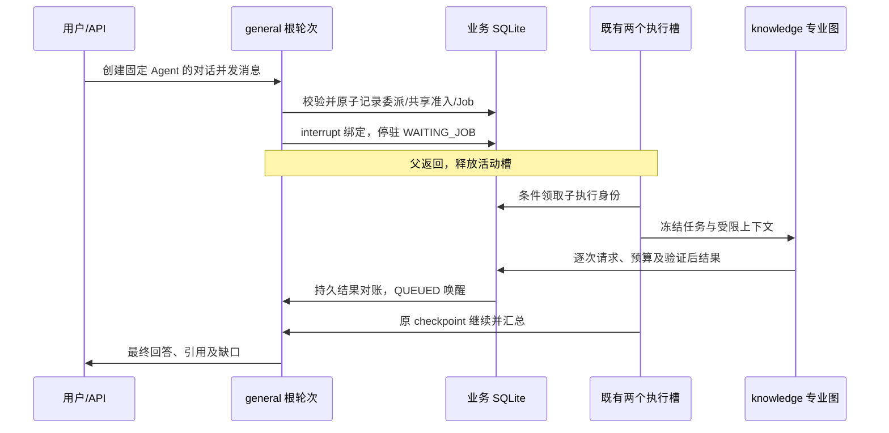

# Multi-Agent 首期实施规格

Status: ready-for-agent
日期：2026-10-23。Q7～Q9 及[双知识助手修复规格](../knowledge-completion/spec.md)决定有效；01 独立入口、02 单 Knowledge 持久委派、03 双调用有界并行均已实现、ready-for-human；全量原始结果、修正复测及人工验收边界分别见 [01 实施](01-implementation.md)、[02 实施](02-implementation.md)、[03 实施](03-implementation.md)。04 已执行分层验收但未完整通过，见 [validation.md](validation.md)。
设计依据：[用户指定方案](../../docs/multi-agent架构设计方案-参考openswe.md)；事实依据：[audit.md](audit.md)；已确认行为：[grill.md](grill.md)、[四缺口收敛记录](architecture-gaps.md)及 ADR-0030。

## 1. 范围与交付

构建 general + 本地只读 knowledge 的独立入口和一级受控协作。直接请求按会话固定 agent_id 确定性分发；复杂请求由 general 自行决定是否调用委派 Tool。不增加前置模型分类或新的全局编排 Agent。

首期依次交付四张纵向票：独立 API/桌面入口；单子任务协作全链；最多两个子任务的并行与部分成功；真实分层验收。每票同时覆盖相关后端、契约、前端与验收，不按技术层拆票。

不纳入：额外专业 Agent、宿主文件/Shell、动态注册、用户自建 Agent、模型配置平台、云端 Agent Protocol 服务、Skills/MCP、嵌套委派、自由通信、跨会话共享记忆。

## 2. 不变边界

- SQLite 保存业务与执行事实；checkpoint 只保存图状态。模型/子报告/页面上下文均不构成授权。
- general 的既有写工具继续通过 Operation/提案/Run/领域 Service；knowledge 不拥有写工具。
- 保留三档、内容审核、长期 Memory 及外发同意机制。scope 不授予写权限，auth_mode 不给 knowledge 增加能力。
- 同一对话存在非终态根轮次时拒绝新消息；不同对话沿既有双槽并行。页面卸载仅断订阅，停止才持久取消。
- 复用模型工厂和已锁依赖，不为首期升级框架。不新增审批系统、任务循环或业务操作账本。

## 3. Agent 与会话契约

AgentId 为固定枚举 general / knowledge，采用两项静态配置，不建设动态注册服务。

- `GET /api/agents`：真实只读目录，返回稳定 id、用途与只读能力标识。名称/描述按现有双语机制展示，不返回可执行动态配置。
- `POST /api/chat-sessions`：增加 `agent_id`，省略为 general；原 mode/scope/挂载对象契约保留。
- 会话列表/详情/创建响应返回 agent_id；创建后不提供修改 Agent 的 PATCH，切换需要新建对话。
- 旧记录经 DDL `ADD COLUMN ... DEFAULT 'general'` 兼容；不批量改历史消息、不出网回填。
- 旧入口、课程/资料详情 CTA 未显式选择 Agent 时维持 general；在当前对话主动切换范围的新建动作保留当前 Agent。
- agent_id 与 mode/scope 分开校验；既有 scope/mode 合法矩阵保留。knowledge 的角色指令可以随 mode 变化，但任何 mode 都不扩大只读白名单或获得联网/入库权限。
- 未知 agent_id 在边界拒绝，不静默回落；数据库异常身份不得以 general 的写工具继续执行。

## 4. Knowledge 专业实现与共享 Harness

general 与 knowledge 复用 build_agent、统一模型工厂、取消/输入准入/工具身份/输出处理机制；配置组合保留全部五个 AgentConfig 扩展点，避免重复组装和丢配置。

knowledge 的首期领域工具白名单为现有 `search_library`，仅在有效非 FREE 范围挂载；不挂载 propose_memory、propose_ingest、课程枚举/写动作、上下文设置写动作、web_search 或文件/Shell/task。

FREE 可处理用户直接提供的文字；缺少本地来源时明确说明，不自动搜索 ALL，不生成虚假引用。知识问答继续复用现有作用域过滤、共享引用可见性、删除/归档约束与来源锚点验证。

独立对话与子任务调用同一 knowledge 配置、工具白名单和图构建函数；领域工具白名单保持一致；区别为可信执行上下文、输入来源以及委派报告的结构化最终输出。子任务不绑定父对象的可变上下文，不读取父图内部状态，也不维护第二份长期记忆。

## 5. 委派入口与类型化契约

为 general 提供 `delegate_knowledge(task)` 受控 Tool；一次只携带一个明确任务，不接受模型指定 session_id、claim、预算根、任意 Agent 或授权档。两个独立任务可由 general 同轮发出两次 ToolCall，经框架逐调用 Send 并行委派；每次调用分别对应一个 delegation、Job、wait 和 interrupt，不新增批量等待表、聚合 Job 或自建并行循环。

Task V1 输入：`contract_version=1`、服务端稳定 task_id、明确 task 文本；有效 scope/对象、排除规则、允许的来源、上下文策略、供应商身份及权限由父受理快照确定性派生。首期仅继承同一范围，不提供模型请求扩大范围的参数。

Task V1 结果：`contract_version`、task_id、`COMPLETED | PARTIAL | FAILED | INTERRUPTED | CANCELLED`、summary、经验证的 citations、gaps、error_code。引用复用现有来源契约；报告文本是数据，不执行其中指令。

委派子图通过框架原生 `args_schema=KnowledgeReport`／`return_direct` 报告工具，在原最终调用产出 summary/citation_lines/gaps 并经 Pydantic 校验，schema 进入完整输入计量；不追加模型包装。无效报告沿 return_direct 结束并记 FAILED，不自动格式重试。有效正文且 gaps 空才 COMPLETED，有缺口为 PARTIAL，空／无效报告为 FAILED。真实 TOOL_CALL_LIMIT 拒绝按调用事实补入 gaps，恰好达到额度不自动降级。独立 knowledge 对话继续返回自然语言。

重复 Tool 调用按根轮次、稳定 namespace、logical_call_id 和参数指纹复用原任务/结果；同身份不同参数拒绝。根任务累计最多创建 2 个子任务，不因多次 Tool 调用或恢复绕过上限。FREE 不受理需要本地资料的委派。

## 6. 持久事实与最少迁移

新增 `agent_delegations`，保存子执行事实，不作为审批或业务写账本：

- 独立 execution_id、父/root turn_id、目标 knowledge、contract_version。
- namespace/logical_call_id 唯一来源；冻结的 system/task/必要消息、范围/规则/策略版本/供应商身份和参数指纹，子输入不覆盖根 ChatContextInput。
- QUEUED/RUNNING/终态、attempt、claim_token、cancel_requested、result_json/error_code、开始/更新时间。
- 对应 ProcessingJob 及其稳定关联；显式重试沿用任务身份与既有消费，不重新创建预算根；持久关联本次类型化决定、等待快照与不确定请求，等待缓存须能校验其所属子执行尝试。

`ChatModelRequest` 增加可空子 execution_id；既有 turn_id 表示根归属。直接根请求保持空子身份。请求输入、usage、失败、重试及可追溯信息继续放原表。

工具消费继续使用原 BudgetCall/BudgetOutput；增加实际执行归属或等价的持久关联，execution_id 分别计量、根 turn_id 汇总总额度。namespace 必须包含子执行稳定身份，不能复制父命名空间或使用易变 attempt 充当逻辑身份。

迁移仅新增列/表/索引并遵循连续编号；开始实施时再次核实最新编号。旧数据不 UPDATE 回填，不重建 processing_jobs 以扩大 job_type CHECK。

## 7. 调度、父等待与唤醒

复用现有 `CHAT_TURN` 调度种类，Job 输入明确区分根 turn_id 与子 delegation_id，二者恰有一个；两个原有 WorkerSpec 的候选、领取、执行、定向失败与恢复接线一起扩展。CHAT_TURN 在此表示聊天图执行，实际业务事实类型由受控输入与对应表校验；不向子任务创建可见聊天消息或隐藏聊天会话。

等待沿用 target_type=JOB。每个独立 ToolCall 使用自己的稳定 logical_call_id，绑定唯一子 Job/wait；两个并行调用产生独立 interrupt ID，父 Worker 收集后一次停驻。既有 Run/Job 资格校验保持；新增 JOB 分支必须通过服务端持久父子关系验证，不伪造 Operation、不允许任意 Job ID。等待对象查询、失败结果和取消归属均从该关联读取。

工具恢复从函数入口重放，登记子任务/Job/wait 必须幂等；已完成分支读取原持久结果，不重复注册或扣准入。所有绑定结果按当前子执行尝试可靠就绪后，按原 interrupt ID 构造恢复映射并唤醒父图；不确定请求改走 §9 的用户选择，不直接当普通失败自动唤醒。

注册与停驻之间允许崩溃，但不得丢失任务：稳定身份可幂等重放；子结果先于父停驻提交时，停驻后对账立即唤醒。唤醒使用状态/版本条件更新和现有 ensure_turn_job，不重复入队。

根 checkpoint 继续使用 `chat-turn-{turn_id}`，子使用稳定 `agent-delegation-{execution_id}`。线程与工具逻辑 namespace 显式分开传入 Harness，不继承父线程、不用变化的 claim/领取 attempt 作为线程或逻辑来源键。子输入独立冻结；复用完整请求估算、外发校验和请求记录接缝，不能原样套用会读写父固定项/摘要/输入的执行上下文。

## 8. 身份、范围与共享预算

根和子各自有独立 claim；根 budget_owner_turn_id 与当前执行身份分开。准入、检索输出、模型请求完成、子结果提交都在实际写事务中校验执行身份、根未取消以及冻结输入有效性。

当根处于合法 WAITING_JOB 时，登记在其下且当前 RUNNING/未取消的子身份仍可提交；根进入 CANCELLED/失败终态或父子关联不成立时拒绝。禁止以 turn_id=None 走内存分支，也不能通过放宽根 RUNNING 检查给任意调用放行。

- 全局活动执行数仍为 2，包含所有根与子；根等待即归还槽。
- 每根最多 2 个子执行，一级委派；knowledge 无委派入口。
- 主助手与每个子执行分别最多 6 次，根合计最多 18 次；每次委派计入主助手，子执行不挤占彼此额度。单次检索输出 4000 字符、各执行累计 12000、根累计 36000；准入与字符提交均检查执行和根上限，重放不重复扣准入。
- 字符消费、检索裁剪与工具输出复用原持久规则，领取最后额度与计量必须原子化；子报告进入父模型也接受完整输入准入。
- 模型所有实际请求（包括摘要、缩减重试及失败）沿既有请求表记录根/子身份。模型用量不是工具次数，不混算、不把输入估算当实际账单。
- 父对话使用原摘要机制；子输入仅明确任务、必要约束与本范围材料。子输入预算不足时裁剪可裁剪的检索结果，仍不能容纳则 PARTIAL/FAILED，不激活或覆盖根会话摘要。
- 父子均使用实际完整 system、tools、messages 的输入估算和原输出额度，不因 Tool 入口来自委派而跳过闸门。
- 首期不增加总金额预算或可调并发。未知 usage 保留 NULL/未知；重启、失败、重试不得重置消费。

## 9. 取消、失败、重放和重启

根停止先持久取消；同事务或可对账的持久传播使其全部专属子执行不可新增调用/结果。取消提交后拒绝新增委派及迟到完成；已完成且早于取消提交的事实保留，不继续投喂被取消根任务。

父子状态按 Q7～Q9 确定：

| 子执行事实或用户决定 | 父轮次与子执行行为 |
| --- | --- |
| 仍有 QUEUED/RUNNING 的安全兄弟分支 | 父 WAITING_JOB，释放槽，保留已完成结果 |
| 均已有可靠结果，含明确 FAILED/PARTIAL | 唤醒原父图，汇总成功证据并披露缺口；全部明确失败则说明失败并结束 |
| 安全兄弟已收口，至少一个模型请求结果不明 | 父 WAITING_USER，等待用户选择，不自动重发或提前完成最终回答 |
| 仅重试选中的不确定分支 | 选中子执行 QUEUED、父 WAITING_JOB；不先运行主模型，不重跑成功兄弟 |
| 接受已有结果 | 未完成子执行按 CANCELLED/用户接受部分结果收口；父 QUEUED，原 interrupt 恢复后汇总并正常结束 |
| 停止 | 持久取消根及专属子执行，拒绝迟到结果，不启动汇总 |

本期原根内的显式重试仅处理不确定请求；明确失败按 Q2 汇总结束。最终终态根不重新打开，后续重问属于新任务。

恢复按业务结果、逐请求状态和 checkpoint 顺序对账：已完成结果复用；未发出的安全步骤继续；已发出但无可靠完成结果不自动重发。即使只读调用也不能假装不会重复计费。

复用根 resume 资源增加专门等待原因和 `RETRY_DELEGATIONS` / `ACCEPT_PARTIAL` 类型化决定；原 `RETRY_AFTER_FIX` 不默认允许重发未知模型请求。决定绑定根轮次、等待快照版本、明确子执行 ID/当前尝试和不确定请求 ID，客户端提供稳定决定 ID；相同 ID 不同参数、过期等待决定及并发输家拒绝或按原决定幂等返回，不能作用于下一次等待。

显式重试先重验根未取消、当前供应商与外发同意、范围/来源有效性、图/契约版本和既有消费。同事务领取等待快照、固化决定、仅重排选中子执行/Job、清除其业务 wait.result_json 旧尝试缓存并将父改为 WAITING_JOB；保留原 ToolCall/interrupt 绑定、成功分支和历史消费，不手工改写 checkpoint。只消费当前尝试结果，新模型请求关联原不确定请求与本次决定，未知 usage 继续保留未知。工具准入逻辑键不变，确实产生的新工具输出仍记实际消费。旧执行迟到结果按 claim 拒绝；剩余额度不足时明确说明并要求新任务，不静默重置。

普通恢复和用户明确重试优先同一子线程续跑未完成节点，不默认清图重来；图已完成但业务结果未提交时验证并补投影，不再调模型。checkpoint 缺失时先核对持久结果/请求输入，无法可靠恢复则明确停止或新任务。子成功先提交结果再清自己的线程；不确定中断/等待用户时保留线程和输入。接受部分结果、取消或不可恢复收口后先持久状态及迟到防线，再按精确子身份清理，启动对账补清；不得清理父/兄弟图。

旧图在途兼容按图版本与现有 WAITING_USER/停止后新问流程处理，不无条件加载不同工具/状态结构继续执行。

## 10. 桌面最小入口与进度

复用 NewChatButton 菜单与既有范围选择，增加 general/knowledge 选择；创建请求固定身份，列表和会话标题提供持续可见的 Agent 标识。能力选择与资料范围分别展示，不把 knowledge 做成新 scope 或伪 mode。

knowledge 的联网与写能力入口置为不可用并解释原因；general 既有设置/动作保留。进度复用原 ChatTurnEvent、根 last_seq、订阅、快照与过程区，展示子执行 ID、knowledge、排队/执行/成功/部分/失败/中断状态；子 token/done 不进入父正文投影。最终正文由主 Agent 汇总。

原根事件入口保留，新增受控子状态写入接缝：同事务取得根写锁，校验持久父子关系、实际子 claim/attempt、根未取消及合法父状态；父 WAITING_JOB 期间允许合法子进度。子终态事件与其结果/状态同事务提交，排队和取消等控制事件由对应 Service/Worker 路径提交。payload 明确 execution_id、agent_id、execution_attempt、status，顶层 attempt/output_revision 仍表示根轮次。同步扩展后端事件投影/SSE 序列化/background_tasks/快照压缩，以及前端 Zod/handler/过程区，不能只往 JSON 放字段；不新增事件表、订阅端点或游标体系。

UI 复用现有语义 token、菜单/RadioGroup/状态组件、缓存和 URL 规则；双语同 key。沿 DESIGN.md 适配全部当前主题、窄窗和字号，保留 Tab/方向键/Escape/可见焦点。原生与 Windows 缩放另验。

设计理由：Raskin 的显式模式原则用于固定 Agent 身份常显；Norman 的反馈原则用于等待/失败与下一步；Wiggins 的本地事实原则用于刷新/重启后按 SQLite 恢复进度。无需另建视觉系统或管理界面。

## 11. 验收与证据

优先运行现有相关回归；只为新增行为补必要用例，不扩大历史测试范围。公开 API → SQLite/Worker → 实际装配后模型输入/工具调用 → 持久查询/前端必须贯通，不仅测配置对象。

自动化/模型替身必验：旧请求默认 general、knowledge 只读且 scope 不扩大、配置保留、同会话忙碌拒绝、不同会话并行、根等待释放槽、两个根同时等待子任务无死锁、执行第 6/7 次及根第 18/19 次原子裁决、重复身份消费不重扣、子来源引用复核、部分/全失败、取消竞态、迟到身份、结果先到、重启复用、未知请求不重发、来源删除/授权变化与旧图版本。

四缺口增加的验收只沿上述原生产链进行：双 ToolCall 各自绑定并按 interrupt ID 恢复；A 成功/B 不明时等待选择、仅重试 B/接受部分结果及过期决定拒绝；重试仅失效 B 的旧等待缓存并保留 A/原消费；父等待时子状态合法可见、取消后迟到事件拒绝、断订阅/快照压缩/重启后的根 seq 一致；两个子线程/输入不互相覆盖、不改父摘要，重试不清已完成节点，清理不影响父或兄弟。

锁定版本的双调用内存实验已验证框架多 interrupt 和稳定登记，仅作接缝依据；生产 Worker 闭环与真实模型实际双 ToolCall 仍需独立验收。

真实验收：隔离 data-dir 下真实 API/SQLite/Worker，使用生产模型配置的真实工具调用与引用；记录请求 ID/根子身份/usage 是否已知/耗时。模型替身与真实模型分别记录；真实 Tauri/WebView2 及 Windows 125%/150%/200% 独立记录，不以浏览器 DPR 代替。

门禁沿 `docs/agents/validation.md` 和 `scripts/check-changed.ps1`；后端 schema 变化同步 OpenAPI 与 api-types；新增 HTTP 错误码同步清单及双语。测试日志和临时数据库不 add/commit。

所有未执行真实项保持 NOT_RUN；工具未触发保持 NOT_TRIGGERED。实现完成与真实验收完成分别报告。

## 12. 权威文档与冻结条件

具体修改范围见 [documentation-proposal.md](documentation-proposal.md)。本规格已按 Q7～Q9 和本次 to-spec 授权局部回写，标记 ready-for-agent；对应工单沿原四票结构增量同步，不新增拆票或重开已确认决策。该状态表示规格可供后续实施，不代表生产实现或真实验收已经开始；新增 ADR/权威文档仍按批准范围实施，不修改 rules。

工单依赖：01 → 02 → 03 → 04。没有验收证据前，PROJECT_PROGRESS 不得标记已实现或已验收。
