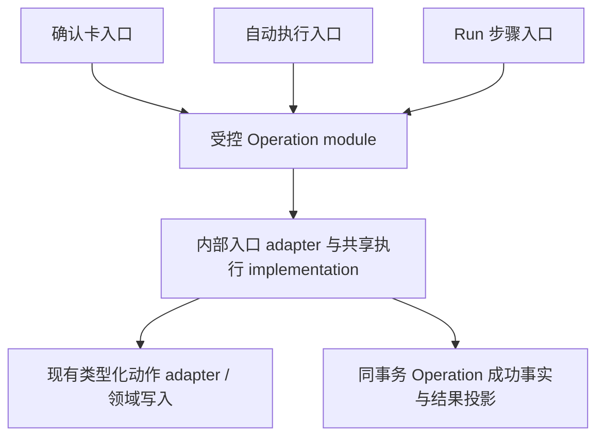

# 加深受控 Operation module

Status: done（代码与本票自动化验收完成；验证限制见 implementation.md）

日期：2026-10-12。基线：`74eb87a5866d7966b44908089b4f949039dca6e8`。

用户已确认：严格保持现有行为；覆盖确认卡、自动执行和 Run 三条入口；Undo/Retry 仅做新契约所需适配；一份简短规格、一张完整闭环工单。用户本轮调用 implement 授权实施；当前代码已实现，最终验证范围见 implementation.md。

## Problem Statement

新增或维护 Agent 写能力时，维护者需要分别理解确认卡、自动执行和 Run 的快照重验、领域应用、结果投影与记账流程。已有 Operation 注册表复用了动作声明与应用器，但调用方仍承担较多执行编排知识，容易在扩展时漏掉事务、授权或恢复约束。

应用器还依赖审批用的 AgentProposal ORM；自动执行和 Run 为调用应用器构造未落库的临时 Proposal。这泄漏了审批实现细节，并掩盖了个别动作对身份字段的真实依赖。

## Solution

把受控 Operation module 加深：三条入口经内部 adapter 接入共享执行 implementation，收拢重复的执行知识，保留入口真实差异。动作 adapter 接收类型化载荷与确有需要的执行标识，复用原领域写入能力。用户继续使用原工具、确认卡、任务与回执，不增加操作步骤。

Depth 的验收依据是 interface 所需知识减少：调用方不再逐个拼装快照读取、比较、应用、结果校验与成功记账。Locality 集中在受控执行 module；Leverage 同时覆盖三条入口。保留现有动作注册 seam，不另造插件框架。

## User Stories

1. 作为用户，我希望原有写工具继续按当前授权规则执行或生成确认卡，以便重构不改变操作体验。
2. 作为用户，我希望目标被修改后旧批准仍被拒绝，以便 Agent 不覆盖后续修改。
3. 作为用户，我希望取消或失效执行身份仍能阻止未提交写入，以便停止行为可信。
4. 作为用户，我希望业务写入和成功回执原子提交，以便重启后结果可核对。
5. 作为用户，我希望中断恢复复用已成功结果，以便不会重复创建对象或投递任务。
6. 作为用户，我希望 Run 保留独立步骤结果、等待、取消和重试行为，以便已完成工作不丢失。
7. 作为维护者，我希望新增动作复用现有声明和受控执行流程，以便不复制三套执行规则。
8. 作为维护者，我希望动作应用器无需审批 ORM，以便执行载荷与必要身份依赖明确且可类型检查。

## Implementation Decisions

1. **范围**：覆盖所有当前已注册动作的应用器契约及三条执行入口；非 Operation 提案继续使用通用提案框架。内部迁移可分步骤，交付必须三入口全部接通。
2. **对外 interface**：分别接收确认提案、自动执行 runtime、Run 及其 Operation 的真实上下文，不让调用方传 `authorized=True`、任意事务回调或组合策略开关。共享执行细节与入口差异 adapter 均在 module 内部，不公开万能参数包。
3. **共享 implementation**：收拢载荷解析与类型校验、目标及快照处理、领域应用、结果校验、Operation 成功记账与投影；执行资格按入口依据重验。错误码、校验时点及顺序保持现状，不把提交校验器额外加到原本不调用它的路径。
4. **事务归属**：既有入口持有事务；执行 implementation 参与该事务，不内部开启或提交另一笔业务事务。业务写入、成功 Operation 与本入口原有投影及 effect 收口保持同事务。回滚后的失败事务由相应入口 adapter 按原协议处理。
5. **确认入口**：通用提案框架保留条件抢占、编辑合法性校验、提案状态与 HTTP 错误包装；Operation adapter 处理受控执行。显式确认依据保持，不新增会话授权档重检。成功新增关联 Proposal 的 Operation；失败只标 Proposal FAILED，不新增 FAILED Operation。
6. **自动入口**：保留当前授权分流、预算、派生基线与瞬态重试协议。持久取消和领取身份在业务事务内最终校验；该拒绝仍不产生 FAILED 回执。失败回滚后的独立 Operation 记账保持现状，不顺带修补或调整独立失败事务的现有 guard 行为。
7. **Run 入口**：计划解析、依赖、输出引用绑定、取消收尾、等待、触发交接和恢复仍由 Run 持有。执行 adapter 使用当前 Run/Operation 身份与批准依据；成功更新原 Operation，不创建替代行。等待 Job 由原结果与声明驱动，Run 生命周期不移入共享应用器。
8. **差异保留**：确认路径快照按原始 JSON 字符串比较；Run/单步手动重试按解码结构比较；自动执行按原字符串及首次/派生基线比较。Run 引用注入后补固化空快照的规则保持。已批准计划与授权档 Run 的降档规则、各入口异常分类、等待分流、重试次数与 attempts 历史分别保持。
9. **动作契约**：动作应用器改为类型化载荷与必要执行标识，不接收 AgentProposal ORM，也不通过伪 Proposal 兼容旧契约。审批 ORM 仅留在确认 adapter。必要标识由后端入口生成或提取，不能由模型提供，不把执行标识当授权。
10. **身份兼容**：需要身份字段的动作必须显式迁移；保留当前各入口标识来源、重试轮次生成方式、持久 Job 载荷及恢复语义。不能在解除 ORM 依赖时把旧临时标识直接替换成真实 Operation ID。已投递 Job 仍能按原契约处理。
11. **幂等**：复用现有 prepare/complete effect 和条件抢占；成功重放先于预算与参数执法，返回原对象及回执身份。Operation 执行事实、Proposal 审批事实与 effect 恢复事实保持分立，不合并账本。
12. **Undo/Retry**：只迁移受新调用契约影响的代码。保留补偿校验、并发条件抢占、原 Operation 身份、attempts 与并发输家返回当前投影；不扩展可撤销动作或重试授权规则。
13. **能力与数据**：原类型化 Tools、HTTP/OpenAPI/SSE 及回执结构、授权档、数据库与 checkpoint 格式保持；不增依赖、迁移、通用 action 工具或新执行平台。沿用 ADR-0026 与现有确定性领域写入；不引入 LLM 执行规则。

## Testing Decisions

测试 seam 优先选原受控提交入口、Proposal 确认入口和真实 Run/JobRunner 推进入口；验证持久业务结果及原公开投影。现有这些 seam 的覆盖保留，不另建仅测试私有 helper 的体系。

| 编号 | 必须保持的可观察行为 |
|---|---|
| A01 | 原工具、授权分流、公开 payload/result、HTTP/SSE 与回执形状保持；非 Operation 提案无回归 |
| A02 | 确认成功时业务、Proposal 与成功 Operation 原子落库；失败按原协议记 Proposal，不补 FAILED Operation |
| A03 | 自动执行与 Run 的业务及成功 Operation 原子提交；自动入口 effect 结果同时提交；异常时业务回滚，失败记录遵循各入口协议 |
| A04 | 取消优先提交或身份失配时不新增业务副作用；已提交结果保留；Middleware 不替代提交事务内最终 guard |
| A05 | 各入口快照比较、缺失快照、派生基线、重试期间目标变化及引用注入后补快照保持 |
| A06 | 降档约束原有自动执行与授权档 Run；显式批准计划仍按原授权依据执行，不扩大目标集合 |
| A07 | 成功 effect 重放复用原结果，预算满仍可恢复；参数指纹冲突仍拒绝；不重复对象、回执或 Job |
| A08 | Run 依赖失败、独立步骤继续、WAITING_JOB、重启接续及失败重试保持，已成功步骤不重做 |
| A09 | Undo 与单步/Run Retry 沿原身份执行，保持快照、版本、attempts、并发抢占和补偿边界 |
| A10 | 动作应用器不依赖审批 ORM；三入口不再重复编排共享执行流程；仅改变应用器参数或移动代码不算完成 |

优先运行现有授权档、修改动作、批量 Run、Undo/Retry、多来源任务、Run 等待、计划编辑、Proposal 与 ChatTurn 恢复相关测试，按实际影响选取。先记录相关基线，历史失败单列；不删除行为断言或降低 guard 来使测试通过。只有当前契约迁移造成现有覆盖缺口时，补最小必要回归。

并发、回滚和恢复至少使用迁移生成的真实 SQLite、现有公开入口及真实 JobRunner；模型/网络可以使用既有替身并明确标注。类型检查、触及代码的规范检查与公开契约差异检查按仓库现有命令执行。全量历史门禁与真实模型/Tauri 验收分别记录，未执行不代勾。

## Out of Scope

- 工具预算治理、计划编译器、ChatTurn 整体改造、RAG/Memory、Skills/Subagents 扩展。
- 合并 Proposal/Run/ChatTurn/Job 状态机，统一全部失败/快照语义，调整动作风险分级。
- 新增数据库结构、迁移、依赖、公开协议、页面功能或新的通用抽象框架。
- 顺带修复历史缺陷、扩大测试覆盖率、删除与本次契约迁移无关的旧代码。
- 修复下述草案 Job 身份关联问题；它不是本票前置依赖。

## Further Notes

### 独立待复现项：草案 Job 身份关联

静态事实：草案动作把应用器收到的 Proposal ID 写入 Job 的 operation_id；确认入口使用真实 Proposal ID，自动/Run 入口使用新建临时 Proposal 的 UUID。Run 成功处理未把该字段改成真实 Operation ID。草案 Job 写回按此字段查 Operation→Run→会话，找不到时确认卡会话归属为空。

证据符号：`run_operation_applier`、`apply_plan_draft_generate`、`advance_step`、草案 Job `writeback`。现有多来源主闭环验证了草案卡存在/状态，未覆盖该卡的会话归属。尚未进行针对该问题的运行时复现，不宣称测试失败或完整确认全部影响路径。

独立后续复现应通过真实 Run/JobRunner 投递草案任务，比较 Job 标识、真实 Operation/Run 及生成卡的 session_id；修复身份契约须另定行为范围。本重构用显式执行标识保持既有来源规则，不把既有错配解释为应长期采用的架构规范。

### 交付记录

实现工单：[01：收拢三入口受控执行并解除审批 ORM 耦合](issues/01-deepen-controlled-operation.md)。用户已调用 implement 实施本票。无新增领域术语或 ADR 冲突，权威规范不变；项目进度与实际验证范围随本票收口更新。
