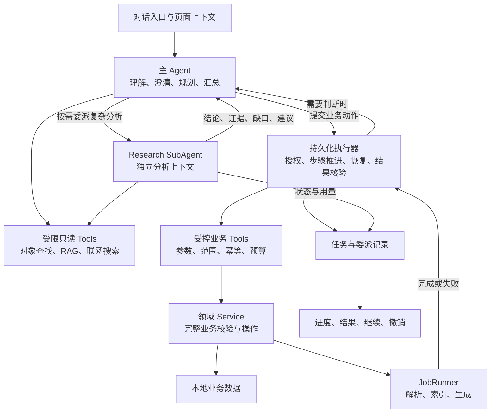

**建议把 KnowRealm Agent 定位为“理解学习任务、调用领域能力、对执行结果负责的通用助手”。沿用现有 DeepAgents + LangGraph + Service + JobRunner 架构，重点补齐受控操作和持续执行能力。**

你描述的方向可行，但不能仅靠增加 Prompt 和 Tools 完成。真正需要建立的是：**上下文识别 → 必要澄清 → 任务规划 → 授权判断 → 执行 → 验证 → 恢复或撤销**的完整闭环。

本文是待实施的设计提案：第 1 节说明已核对的实现基础，其余章节描述演进方案，不代表能力已经上线。SubAgent 纳入架构设计，首个试点为受控的只读研究分析；启用条件、契约和验收见第 9、11 节。涉及现有 ADR 的变更仍须单独定稿，本文不替代现行授权与记忆规则。

**1. 当前已经具备哪些基础**

| 领域           | 当前状态                                                     | 对通用 Agent 的意义                |
| -------------- | ------------------------------------------------------------ | ---------------------------------- |
| Agent 框架     | 已使用 `create_deep_agent`，预留 tools、subagents、skills、backend、middleware | 可以在现有骨架上扩展               |
| 本地 RAG       | 已有统一 `search_library`，支持五档会话范围及来源引用        | 复用检索和范围约束                 |
| 联网与研究     | 已有联网搜索、研究会话、研究入库提案                         | 可以成为复杂任务的信息获取环节     |
| Learner Memory | 已有偏好、学习状态聚合、记忆提案与外发控制                   | 复用已有记忆治理                   |
| 写操作提案     | 已有 `agent_proposals` 及确认应用机制                        | 可以扩展授权与操作追踪             |
| 业务服务       | 已有课程、记录、资料、Todo 等 Service                        | Tools 应调用这些能力               |
| 后台任务       | 已有 JobRunner 和各类 Worker                                 | 继续承担解析、索引、生成等处理任务 |

但当前存在几个直接影响设计的缺口：

- **聊天生命周期不能直接作为长任务生命周期。** 当前每轮聊天开始及正常结束都会清理 checkpoint，尚不具备产品级跨轮任务恢复。[代码 (line 373)](E:/workspace/project/my/KnowRealm-AI/backend/app/modules/agent/graph.py:373)
- **页面上下文尚未形成通用消息契约。** 当前发送消息的请求只有正文和联网开关；已有会话范围，但没有完整的页面、选中对象、附件上下文。[代码 (line 120)](E:/workspace/project/my/KnowRealm-AI/backend/app/modules/agent/schemas.py:120)
- **工具事件主要围绕检索设计。** 现有 `query / hits / ok` 无法充分表达创建对象、等待审批、后台任务及部分成功。[代码 (line 93)](E:/workspace/project/my/KnowRealm-AI/backend/app/modules/agent/graph.py:93)
- **业务能力与用户描述并非完全对应。** 当前 Todo 绑定 Record；课程创建有场景与深度要求；速记与课程文本记录有不同语义。

因此，应当同时做“Agent 执行能力”和“必要的业务能力补齐”，不能把业务缺口藏在工具里。

**2. 推荐的整体架构**



保持以下职责边界（均可位于现有 FastAPI 模块化单体内，不代表新增独立服务）：

- **Agent 决定下一步做什么。**
- **SubAgent 承担可隔离的研究分析，返回证据与建议；主 Agent 统一澄清、汇总和提出业务动作。**
- **持久化执行器推进 Agent Run，管理授权、委派和 Job 等待；模型停止输出后，任务仍可查询和恢复。**
- **Service 决定操作是否合法、如何完整执行。**
- **JobRunner 承担需要后台处理的工作。**

LLM 用于语义理解、内容生成、复杂规划；对象校验、权限判断、状态转换、幂等、索引更新由程序完成。

同进程内 Tool 可以直接调用 Service，不必先把所有内部功能包装成 MCP，也不必绕回本机 HTTP。主 Agent 的业务写入统一经过执行器与受控业务 Tools；首个 SubAgent 仅开放受限查询能力，不具有业务写入口。

但这里有一个实际问题：**目前部分完整业务流程仍包含路由层编排。** 例如删除课程后，路由还负责触发掌握度重算。工具如果只调用 `CourseService.soft_delete`，会遗漏后续动作。应把这种完整操作收拢为可被 HTTP 和 Tool 共用的应用服务入口。[代码 (line 82)](E:/workspace/project/my/KnowRealm-AI/backend/app/modules/course/courses.py:82)

此外，当前提案应用器拥有事务，而部分 Service 自己开启事务；接入写工具前需要明确事务归属，不能直接套用后声称操作与审计已原子提交。

**3. 意图理解、澄清和 Planning 应如何配合**

不建议先建设一个独立、复杂的“意图分类平台”。第一阶段由同一个 Agent 结合结构化工具完成理解和行动，代码负责约束执行。

应区分三种情况：

| 情况                           | 行为                                       |
| ------------------------------ | ------------------------------------------ |
| 简单、目标明确、参数齐全       | 校验后执行，返回结果                       |
| 缺少必要信息或目标有歧义       | 保存任务草稿，只询问阻塞项                 |
| 多步骤、有依赖或部分步骤不确定 | 形成简短计划，持续执行到完成或遇到真实阻塞 |

**Clarification 和 Planning 是两件事。** 缺一个课程名称只需要补问，不必进入完整规划流程；复杂任务即使信息齐全，也可能需要规划。

以“帮我创建课程”为例，当前业务实际要求：

- 课程名称；
- 学习场景；
- 学业场景对应教育阶段，职业或兴趣场景对应学习深度。

课程说明是可选项，“是否导入资料”也不应成为创建课程的必答题。[创建契约 (line 61)](E:/workspace/project/my/KnowRealm-AI/backend/app/modules/course/schemas.py:61)

已有可靠上下文可以补全这些字段；但“用户是程序员”不能直接等同于“这门课程一定是职业学习”。项目术语已明确角色和课程学习场景的区别。

建议保存结构化任务草稿，记录：

- 已确定字段及其来源；
- 待补字段；
- 已解析目标对象；
- 当前等待的问题；
- 用户最新修改。

用户回复“入门就好”时，应继续同一个任务，而不是重新解释整段聊天。

对于学习计划，计划步骤还需要有**完成条件**：创建课程完成于得到真实课程 ID；资料入库完成于本地快照落地；内容检索可用则还需等待解析和索引完成。

DeepAgents 的规划清单可以辅助组织工作，但不能直接当作业务完成记录。

多步骤不自动触发 SubAgent。只有独立子问题需要多轮检索、专项工具或隔离大量中间材料时，主 Agent 才提出委派；执行器检查范围与剩余预算后运行。简单学习计划由主 Agent 配合场景 Skill 完成，固定批处理由程序完成，详见第 9 节。

**4. Context Awareness：上下文必须有来源和边界**

建议每次发起任务时附带一个有限的上下文快照：

| 内容                | 用途                   |
| ------------------- | ---------------------- |
| 当前页面与对象 ID   | 理解“这里”“这个课程”   |
| 选中的对象 ID、类型 | 理解“这 5 篇论文”      |
| 选中文字及来源定位  | 理解“把这段整理成笔记” |
| 当前会话范围        | 确定可检索资料范围     |
| 用户时区与当前日期  | 解析“今天”“下周”       |
| 已授权附件引用      | 确定可导入的文件       |

目标解析建议采用：

**用户明确指定 → 本轮明确选择 → 当前任务已确认目标 → 当前页面 → 已确认记忆或偏好。**

发生冲突时，优先遵循明确指令；无法唯一确定目标时才追问。

例如同名“Python 学习”课程有两门，应展示场景、更新时间等区别供用户选择，不能拿第一条搜索结果直接写入。

还必须区分：

- **页面上下文**：帮助理解用户指代。
- **资料读取范围**：哪些内容可以检索。
- **操作授权范围**：哪些对象可以被修改。

它们不能互相替代。当前打开某个课程，不等于允许批量删除它的记录；资料检索为 ALL，也不等于拥有全库写权限。

任务开始后固定目标快照，用户切换页面不应让进行中的任务悄悄更换课程。执行前仍须重新检查对象是否存在、归属是否变化。

委派时从父任务快照中提取最小必要上下文，不默认复制全部聊天、页面内容或 Learner Memory。子任务的可读范围是父任务授权范围与本次指定来源的交集，由运行时绑定并在工具执行端校验；模型填写的课程 ID 或来源列表不能扩大权限。父任务资料范围、用户目标或来源版本变化后，旧委派结果须重新校验，不能直接进入当前计划。

**5. Tools 应围绕真实业务动作设计**

工具应有明确参数和结果，不提供 `execute_sql`、任意 API 调用或通用主机 Shell 来绕过业务规则。

| 工具组           | 建议能力                               | 当前需要注意                     |
| ---------------- | -------------------------------------- | -------------------------------- |
| Course           | 查找、读取、创建、修改、归档、删除     | 删除存在关联影响                 |
| Record / Capture | 创建文本记录、读取、修改、分类、移动   | 复用捕获流程，区分速记与课程记录 |
| Library          | 查找资料、导入、关联、归类、归档、恢复 | 来源与 Record 生命周期独立       |
| Learning Task    | 创建、修改、完成学习任务               | 现有 Todo 绑定 Record            |
| Knowledge        | 查询概念和证据、请求构建、提出候选修改 | 不绕过现有审核规则               |
| Search / RAG     | 查找业务对象、获取资料证据             | 对象查找与证据检索应分开         |
| Memory           | 读取相关记忆、提出修改、删除           | 沿用已有治理和外发约束           |
| Execution        | 查询任务、取消、恢复、申请撤销         | 属于新增执行能力                 |

**业务对象搜索不能完全依赖 RAG。** 找课程应返回准确的课程 ID 和状态；回答“资料中如何解释 FastAPI”才需要证据检索。

工具结果至少应能区分：

- 已完成；
- 已受理，后台处理中；
- 需要补充信息；
- 等待授权；
- 失败；
- 部分成功。

并返回相关对象、Job、操作记录的 ID。后台任务受理成功，不能被 Agent 表述为“全部完成”。

工具目录可以按任务加载，避免每轮都暴露大量工具；但隐藏工具只用于减少噪声，真正的授权校验仍须发生在执行端。

**6. 自动执行与高风险确认，需要调整现有授权契约**

当前 [ADR-0024](E:/workspace/project/my/KnowRealm-AI/docs/adr/0024-unified-library-item-and-rag-boundary.md) 要求 Agent 写入先提案、用户确认。要实现你要求的“信息足够就直接创建”，建议将其演进为：

**所有写操作经过受控执行；低风险操作可依据明确指令和授权策略直接执行，高风险操作确认后执行。**

这是待定稿的契约变更，不能只靠 Prompt 宣布开启。

| 操作                             | 建议默认行为                 |
| -------------------------------- | ---------------------------- |
| 授权范围内查询                   | 直接执行                     |
| 明确要求创建课程、记录、单条任务 | 参数齐全、影响明确时直接执行 |
| 单对象小范围编辑                 | 展示结果和可用撤销能力       |
| 批量移动、覆盖正文、删除课程     | 先展示对象清单与影响，再确认 |
| 物理删除、向外部服务发送内容     | 单独明确授权                 |
| 修改长期记忆                     | 继续遵循现有 MEMORY 提案规则 |

不要让模型自行判定风险等级；由工具及领域规则决定。

批量确认必须绑定**具体对象集合、动作参数、对象版本和授权有效范围**。批准“归档这 5 篇”后，重规划不能偷偷追加第 6 篇。

用户已经批准的任务，可在授权范围内连续执行；新出现的高风险动作、外发对象或显著费用变化才再次确认。

授权不会因委派而扩大：SubAgent 无权批准业务动作、修改长期记忆或自行切换外部供应商。其返回的建议与引用属于待校验结果，不构成用户指令；后续业务动作仍由主 Agent 提出并经过同一执行入口。子任务使用外部模型或联网工具时，继续执行现有来源片段、记忆外发与供应商同意校验。

DeepAgents 提供基于 interrupt 的审批与恢复机制，可以复用；但产品的授权记录仍需保存在业务数据库中，不能只存在暂停的 Graph 里。[官方说明](https://docs.langchain.com/oss/python/deepagents/human-in-the-loop)

**7. 长任务、中断和恢复，需要独立的 Agent Run**

建议明确区分以下对象：

| 对象            | 表示什么                                          |
| --------------- | ------------------------------------------------- |
| Chat Session    | 用户与助手的对话                                  |
| Agent Run       | 一次用户目标，例如“整理这 5 篇论文并创建学习计划” |
| Delegation / 委派 | Agent Run 内的一次有界分析子任务，不是独立用户目标，也不是业务 Job |
| Job             | 一个后台处理环节，例如解析一篇 PDF                |
| Todo / 学习任务 | 用户需要完成的学习行动                            |

它们不能混成同一种“任务”。

最小持久化设计可以围绕 `AgentRun` 和其操作记录展开，保存目标、上下文快照、计划版本、当前状态、操作结果、关联 Job 与提案。具体表结构应在实施规格中确定，避免预先建设通用工作流平台。

启用 SubAgent 时，把委派作为父 Run 的有类型步骤记录，关联委派标识、尝试次数、输入版本、状态、结果引用和用量；不预先建设独立子任务平台。框架 checkpoint 承载运行态，业务数据库保存委派是否完成及已接纳的结果。持久化执行器只协调业务步骤、委派与 Job，不重复实现 LangGraph 的模型循环。

典型执行过程：

```
运行中
  → 等待用户补充
  → 等待授权
  → 等待后台 Job
  → 等待研究子任务（按需）
  → 继续运行
  → 完成 / 部分完成 / 失败 / 已取消
```

复用 LangGraph checkpoint 保存推理与编排状态；业务数据库记录真实操作结果。官方框架支持 checkpoint 持久化和中断恢复，但当前聊天主动清理 checkpoint 的策略，需要为 Agent Run 单独调整。[官方说明](https://docs.langchain.com/oss/python/langgraph/persistence)

几个关键执行规则：

- Agent 提交解析 Job 后进入等待，不占着模型调用持续轮询。
- Job 完成后唤醒对应 Run，并核验结果。
- SSE 只订阅进度；断开界面不等于取消任务。
- 用户点击停止，应停止后续动作；已提交的修改不会凭空回滚。
- 应用完全退出后，本地 sidecar 无法继续计算；任务应在下次启动恢复。最小化到托盘继续执行与完全退出需要明确区分。
- 同一 Run 不允许两个执行器同时推进；恢复时重新检查授权、对象状态及未决操作。
- 委派的取消、超时、迟到结果和重启恢复统一遵循第 9.4 节；框架提供的同步或异步委派方式不替代产品层的持久化执行契约。

对“整理 5 篇论文”的合理处理是：

```
解析选中来源与目标
→ 补齐新课程必填项
→ 创建课程
→ 复用已有资料或导入新资料
→ 等待解析与索引
→ 按需委派 Research SubAgent 分析主题、先修知识和来源差异
→ 校验证据；主 Agent 结合学习目标生成学习计划
→ 创建学习任务
→ 核验并报告结果
```

如果只解析成功 4 篇，应报告缺失的第 5 篇，以及学习计划是否仅依据这 4 篇生成。

若用户只要求资料归类，则省略研究与计划生成步骤。研究任务按独立问题拆分，不默认每篇论文创建一个 SubAgent；跨论文综合比较可交给同一次委派，避免割裂关系。

**8. 失败恢复与 Undo 必须按业务事实设计**

**幂等是自动执行的基础。** 每个写动作需要稳定的操作标识，重试沿用同一个标识。

例如课程已创建，但返回结果前进程崩溃；恢复后必须找回那次创建结果，不能再次创建同名课程。仅检查名称是否相同不够，因为同名课程可能合法存在。

错误处理至少分为：

| 错误                       | 处理方式                   |
| -------------------------- | -------------------------- |
| 临时网络故障、限流         | 有上限的重试               |
| 参数缺失或目标歧义         | 补充信息                   |
| 对象版本变化、已归档或删除 | 重新读取并调整计划         |
| 外部写入结果未知           | 先核对结果，再决定是否重试 |
| 业务规则拒绝               | 说明原因，不盲目重复调用   |

多步骤任务不应持有一个贯穿全部解析、联网和生成过程的数据库事务。每一步独立提交，保留成功结果，按动作提供补偿。

**Undo 也不是把 checkpoint 回退。**

- 重命名：保存旧值，未被后续修改时允许恢复。
- 移动：保存原归属，检查后续变更。
- 创建：确认没有新增依赖后，才可撤销或软删除。
- 批量整理：逐项记录、逐项补偿。
- 物理删除、外部发送：可能不可撤销，执行前明确说明。

尤其是课程删除已有级联行为，不能承诺“恢复一个字段就能撤销全部影响”。

**9. RAG、Memory、Skills、MCP 和 SubAgent 的职责**

这些能力应共享上下文、权限、预算和操作追踪，但不必统一成一种存储或一种工具。

| 能力               | 核心职责                         |
| ------------------ | -------------------------------- |
| RAG                | 提供有来源的资料证据             |
| Learner Memory     | 提供用户确认的偏好和学习状态     |
| 课程／项目长期事实 | 提供目标、约束、阶段和已确认决策 |
| Skills             | 描述某类任务如何完成             |
| Tools              | 执行具体领域动作                 |
| MCP                | 接入外部工具与资源               |
| SubAgent           | 承担边界清楚的专项子任务         |

对于“项目 Memory”，目前课程仍是唯一知识容器。应先复用课程目标、说明及相关领域事实；确有无法表达的长期决策，再增加明确结构。不要立即建立第二套开放式记忆库。

Skills 可以先从“制定学习计划”“整理研究资料”等少数内置场景开始，按需加载。Skill 提供工作方法，不能授予额外权限。

MCP 应在出现真实外部集成需求时接入，执行仍受同一授权规则约束。网页正文、MCP 输出、导入文档和第三方 Skill 均不能成为扩大权限的指令来源。

**9.1 SubAgent 的使用边界与首个试点**

SubAgent 是主 Agent 的可选分析协作者。首个试点只配置一个 `Research SubAgent`，用于在指定资料范围内进行多轮检索、证据比较和缺口分析；不是每次对话的必经环节。

| 场景 | 执行方式 | 原因 |
| --- | --- | --- |
| 创建课程、添加记录、修改任务 | 主 Agent + 受控业务 Tools | 单步业务操作无需委派 |
| 批量归类、移动、归档 | 执行器 + 领域 Service | 确定性处理，核心是授权、幂等与恢复 |
| 文件解析、索引、固定生成流程 | 既有 Service + JobRunner | 后台处理不等于自主分析 |
| 明确目标下的简单学习计划 | 主 Agent + 场景 Skill | 暂无独立分析上下文的必要 |
| 多篇论文比较、证据冲突、多轮研究 | 按需调用 Research SubAgent | 隔离大量中间材料，返回可核验结论 |
| 多个相互独立的研究问题 | 预算允许时有限并行委派 | 子问题输入完整、互不依赖后才并行 |

Learning Planner 等专项子 Agent 暂不新增；当现有主 Agent + Skill 无法满足实际任务，且独立工具、上下文或评测收益明确后再扩展。第一版仅一级委派，子 Agent 不再委派；并发、调用次数与重试上限由执行器控制。

**9.2 最小委派输入与结果契约**

下列字段是实施时需要满足的语义，不预先冻结数据库表或框架 API：

| 委派输入 | 约束 |
| --- | --- |
| 父 Run、委派 ID、尝试标识 | 可归因、可恢复；重试沿用逻辑委派 ID 并增加尝试号 |
| 明确问题与完成条件 | 子 Agent 必须知道需要解决什么、何时返回 |
| 计划版本与上下文快照引用 | 区分当前任务与已经失效的任务输入 |
| 允许读取的对象、来源及版本 | 由执行器解析并绑定；不接受模型自行扩大范围 |
| 最小用户目标与必要记忆 | 复用现有 Memory 选择和外发规则，不复制完整用户档案 |
| 工具白名单与联网许可 | 显式指定受限查询工具；来源内容不得改变权限 |
| 剩余预算、截止条件与输出要求 | 共享父任务总预算，限制结果体积与证据数量 |

结果至少包含 `COMPLETED / PARTIAL / FAILED / NEEDS_INPUT` 之一，以及结论、来源引用、冲突与缺口、未解决问题和建议动作。建议动作只是数据，不能直接执行。状态、实际用量与错误码由运行时记录，不能依赖模型自报。

本地证据返回对象、Segment / Source Anchor 标识与来源版本，联网证据保留独立来源类型与 URL；无证据时明确标注。较大报告可保存为受控任务产物并返回引用，不让模型任意写入业务目录。需要用户补充时返回缺口，由主 Agent 统一询问并接回父任务。

**9.3 工具隔离与结果接纳**

- Research SubAgent 仅暴露明确配置的资料检索、资料读取及获准的联网搜索；不挂载课程写入、提案应用、Memory 写入、主机 Shell 或任意文件工具。
- 不能假定父 Agent 的中间件、工具限制、Skills 和外发规则自动完整传递；对子 Agent 显式装配，并在每次工具执行时强制检查范围。上下文隔离本身不是安全沙箱。
- 子任务共用父任务的预算账本；并发分配预算时原子预留、结束后结算，不能给每个子任务复制一份完整预算。预算耗尽后停止新增调用，保留已完成结果并报告缺口；已发出的请求可能仍产生费用，需纳入用量记录。
- 接纳结果前，程序校验结构、来源可访问性、范围、版本与引用定位。主 Agent 再综合语义，保留冲突和不确定性；来源定位有效并不自动证明结论正确。
- 主 Agent 需要细节时，通过受限读取工具回查原文；不因为收到简短报告就丢失证据回溯能力。资料、网页、MCP 输出和子 Agent 报告中的指令不获得额外权限。

**9.4 生命周期、失败与恢复**

建议委派状态为 `QUEUED / RUNNING / COMPLETED / PARTIAL / FAILED / CANCELLED`；`NEEDS_INPUT` 是返回结果，本次委派以 `PARTIAL` 收束并记录缺口，由父 Run 转入等待用户补充，信息补齐后以新尝试继续。成功结果应持久化，不能只留在 ToolMessage 或内存中。

- **取消**：父 Run 取消时停止派发，向正在运行的子任务传播取消；无法立即中止的外部调用允许完成记账，但其迟到结果不得推进已取消任务。
- **重规划**：接纳结果时校验计划与上下文版本；旧尝试或旧计划的结果标记为过期，不覆盖当前结果。
- **超时与重试**：短暂故障可在共享预算内有限重试；无证据、缺必要信息和范围拒绝不盲目重试。重试耗时与费用计入父 Run。
- **重启**：保留已完成且输入仍有效的结果；对中断的只读研究按实际框架能力恢复，或记录新尝试后重新运行。恢复不等于无额外计费，也不能重跑已完成的业务写入。
- **部分失败**：主 Agent 明示缺失证据，决定是否在原授权与目标内继续；必要输入缺失时停在待补充状态。部分研究结果不得包装为完整研究。
- **可观测**：事件携带父 Run、委派、尝试标识及序号；界面展示研究问题、状态、用量和失败原因，重连可查询持久化状态。通知用于及时唤醒，恢复仍以数据库对账为准。

SubAgent 不直接写业务，因此无需为其分析结果实现业务 Undo；它所建议的后续操作继续按第 8 节记录和撤销。任务产物、委派结果的保留与清理规则见第 12 节待定项。

**9.5 接入现有 DeepAgents 骨架**

复用 `AgentConfig.subagents` 与 DeepAgents 委派能力，不新增 Agent 服务或通用调度框架。实施前核对项目锁定版本，尤其是默认 `general-purpose` 子 Agent、内置工具、中间件继承、取消和 checkpoint 行为；不能直接照搬最新文档中的异步 API。

当前 `middleware/skeleton.py` 屏蔽 `task`，仅解除该名字不足以完成接入；须同时确保默认子 Agent 无额外能力、子 Agent 的工具白名单与运行时约束生效。`_resolve_agent_config` 当前追加工具时会创建仅带 `tools` 的配置，启用委派时须保留原有 `subagents / skills / backend / middleware` 扩展配置。以上是接入检查点，不代表本轮已修改实现。

框架用法参考 [DeepAgents Subagents](https://docs.langchain.com/oss/python/deepagents/subagents)：子 Agent 适合上下文隔离和专项任务；具体 API 以实施时项目锁定版本为准。

**10. 还需要补齐的产品能力**

有三项业务问题需要优先明确：

1. **课程级学习计划和任务模型。**
   当前 Todo 绑定 Record，没有独立课程级计划、阶段、排期语义。若目标是长期管理机器学习学习计划，应补齐课程级任务能力；不宜为了挂载 Todo 自动制造一条隐藏的假记录。
2. **“添加记录”的语义。**
   当前带课程的粘贴文本会创建记录并尝试进入总结流程，速记则不能直接选择课程。[代码 (line 36)](E:/workspace/project/my/KnowRealm-AI/backend/app/modules/capture/text_capture.py:36)
   “记录今天学习 FastAPI”可能只是学习日志。需要明确是否沿用现有文本学习记录，还是需要轻量日志能力，避免一句记录触发不必要的生成链。
3. **“加入知识空间”的准确动作。**
   当前知识空间是课程的 UI 统称，并非独立知识库实体。[术语 (line 9)](E:/workspace/project/my/KnowRealm-AI/CONTEXT.md:9)
   Agent 应明确是在给来源归类、关联资料，还是移动 Record；来源移动不得擅自级联移动记录。

执行界面还应提供：当前操作对象、简短计划、补充信息入口、审批卡、实际进度、已完成结果、部分失败、继续与可用撤销。展示执行事实和简短原因即可，不需要展示模型内部推理。

启用委派后，在父任务下展示“正在比较论文证据”等有业务含义的子步骤；默认不让用户选择 Agent 名称，不为每个子 Agent 新建聊天入口。失败、缺资料和取消结果统一回到父任务反馈。

同时补齐任务预算和验收指标：最大执行步数、模型费用预算、批量对象上限，以及端到端成功率、无必要追问率、重复写入率、范围越界率和恢复成功率。

**11. 建议的实施顺序**

按可验收的用户闭环推进：

| 阶段     | 用户可获得的能力                                             | 必需基础                                                   |
| -------- | ------------------------------------------------------------ | ---------------------------------------------------------- |
| 第一阶段 | 自然语言查找课程、创建课程、添加课程文本记录；缺信息后接着完成 | 页面上下文、对象消歧、澄清状态、低风险授权、幂等与结果反馈 |
| 第二阶段 | 修改内容、移动资料、批量整理、归档和受控删除                 | 影响预览、版本冲突检测、批量授权、审计与有限 Undo          |
| 第三阶段 | 整理论文并生成持久化学习计划，中断后继续；验证只读研究委派 | 课程级任务语义、Agent Run、Job 等待与唤醒、部分成功恢复；执行闭环稳定后试点 Research SubAgent |
| 第四阶段 | 可复用学习场景与外部能力扩展                                 | 内置 Skills、受控 MCP；有评测收益后再增加专项 SubAgent |

每个阶段都应验证真实结果，尤其是：

- 同名课程不会写错；
- 参数齐全时不会反复追问；
- 响应丢失重试不会重复创建；
- 页面切换不会改变执行目标；
- 用户拒绝后不会继续相同操作；
- 进程重启后不会重复已经完成的步骤；
- 工具受理成功不会被报告为任务完成；
- 恶意资料内容不能触发未授权写入。

**Research SubAgent 启用门禁：**

- 固定相同模型、工具和研究题集，对比单 Agent 与委派方案的结论质量、引用正确率、完整性、总费用与端到端耗时；任务含多来源比较、冲突证据、无答案和部分来源不可用。
- 验证简单创建与归类任务不触发委派；只读子 Agent 无业务写入口，跨课程、越出指定来源、关闭外发后继续调用均被执行端阻止。
- 验证并发预算不会重复分配；父任务取消、重规划、子任务超时和应用重启后，迟到结果不推进失效任务，已完成业务操作不重复执行。
- 验证引用不存在、已删除、来源版本变化及报告夹带指令时，结果不会直接进入写操作；部分完成在父任务和界面上保持可见。
- 先满足权限、引用与恢复正确性，再根据任务质量收益和可接受成本决定启用；具体阈值在第 12 节定稿。收益不足时保留单 Agent 路径。

这些是新增能力的验收要求，不是现有测试或真机通过记录；实施时优先复用已有研究黄金集、范围隔离和任务恢复测试，只补本次新行为未覆盖的用例。

**当前最值得先完成的闭环，是“查找／创建课程 → 在指定课程添加记录 → 缺信息补问后继续 → 返回真实结果”。** 它足以检验通用 Agent 最关键的上下文、授权、业务复用和执行可靠性，再向批量整理及长任务扩展。

**12. 实施规格前需要定稿的补充项**

以下是待决策项，不因写入本文而成为已批准的产品规则：

| 补充项 | 建议方向 | 需要定稿的内容 |
| --- | --- | --- |
| 授权契约演进 | 主 Agent 低风险写入可按明确授权执行；研究子 Agent 首版只读 | ADR-0018 / ADR-0024 的能力与审批边界变更；Memory 继续遵循 ADR-0025 |
| 业务语义 | 先明确第 10 节课程任务、轻量记录和资料关联的含义 | 课程级任务模型，以及“添加记录”是否触发生成链 |
| 执行与事务契约 | 复用现有 Service、提案及 JobRunner | 操作与结果记录的事务归属、Run / 委派持久化结构、Job 完成后的对账恢复 |
| 委派预算与退出条件 | 一级只读委派，限制并发并共享父预算 | 并发数、最大委派次数、超时、重试次数、结果体积与费用阈值 |
| 模型与外发 | 首版沿用当前已配置供应商，避免新增配置负担 | 子模型兼容性、外发同意校验位置、不可用时的降级方式 |
| 来源变化与任务产物治理 | 结果消费前检查范围与版本，产物存于本地可管理目录 | 删除来源后的失效与清理规则、任务产物保留期、导出备份范围 |
| 发布门禁 | 以现有研究黄金集扩充委派场景，保留单 Agent 对照 | 质量提升标准、可接受成本与延迟，以及真机取消／恢复验收清单 |

本文仅更新设计提案；上述方案定稿并进入实施后，再同步相关 ADR、权威模型与项目交接状态。
