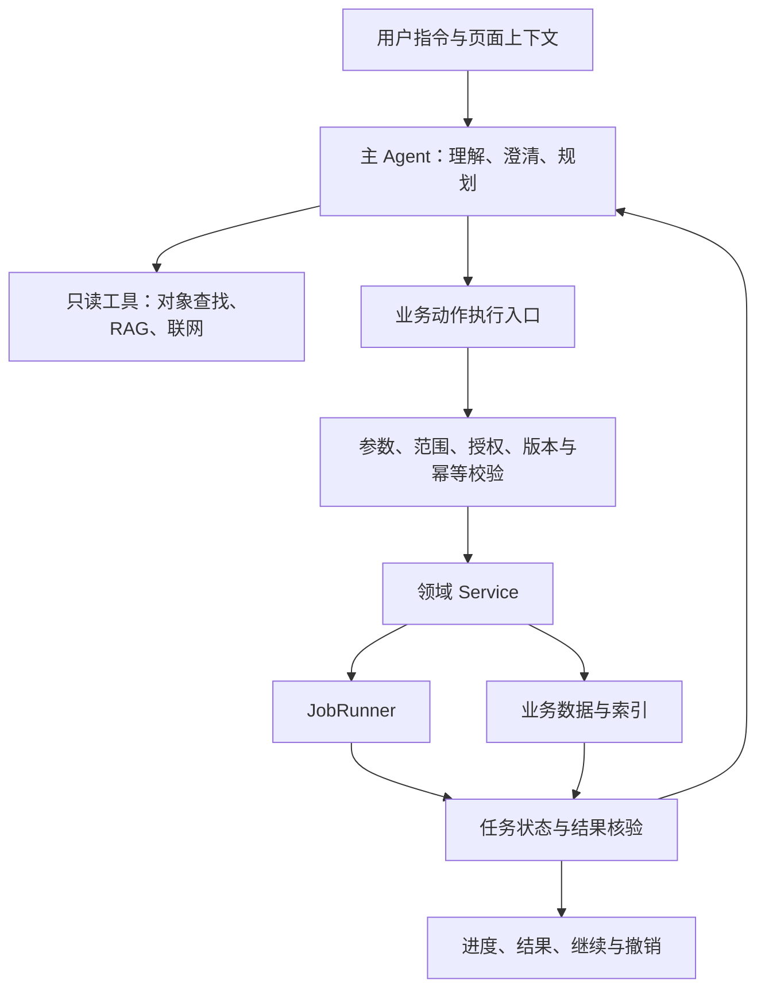

**建议沿用现有 Deep Agents + LangGraph + 领域 Service + JobRunner，将 KnowRealm Agent 从“增强问答”扩展为“能够完成业务任务的助手”。最重要的新增能力是受控操作、持久化任务和结果核验。**

**采纳版（2026-09-21）**：本文修订为通用 Agent 设计的采纳主稿，作为后续 grill→spec→tickets 的设计依据；能力仍未上线；ADR-0026 与扩展文档 §44、§41.1 已登记采纳决策，实施从[开发计划](KnowRealm-AI-通用Agent设计开发计划方案.md)进入 grill。本次修订要点：① 第 6 节授权改为用户可选的三档授权模式（请求批准／帮我批准／完全访问），默认档与现行 ADR-0024 提案规则完全一致，免确认执行成为用户显式选择而非默认行为；② 第 5 节明确写动作工具复用 `propose_ingest` 的判别 payload 实现模式，请求批准档继续以 `agent_proposals` 为审批事实源；③ 第 7 节钉死 Run／Operation 与 `agent_proposals` 的分工、V1 最小形态（不建独立 agent_runs 表）与计划卡（批次授权载体）；④ 第 9 节补回三条既有红线（不叠运行时编排器、不建第二套记忆、Multi-Agent／MCP server 不做）；⑤ 第 10~11 节阶段与定稿清单同步。现状判断基于代码检查，没有执行真机验证；各阶段按实际闭环细化规格，不将全部扩展能力作为首版前置条件。

**1. 当前基础已经够用，但执行闭环尚未建立**

| 能力       | 当前项目状态                                  | 需要补齐                       |
| ---------- | --------------------------------------------- | ------------------------------ |
| Agent 骨架 | 已有 `create_deep_agent`、`AgentConfig`       | 按任务开放业务工具             |
| RAG        | 已有统一 `search_library`、范围隔离和来源引用 | 保持复用                       |
| 研究       | 已有联网搜索、研究会话、入库提案              | 与执行任务衔接                 |
| Memory     | 已有 Learner Memory、确认及外发控制           | 课程目标、约束等长期事实       |
| 业务操作   | 课程、记录、资料、Todo 已有服务               | 面向 Agent 的受控入口          |
| 人工确认   | 已有 `agent_proposals`                        | 三档授权模式（第 6 节）、绑定具体操作 |
| 后台处理   | 已有 JobRunner                                | 多步骤任务推进与恢复           |
| 过程反馈   | 已有检索工具事件                              | 持久化执行状态、部分成功、撤销 |

三个代码约束尤其重要：

- **课程创建不只需要名称。** 还需要学习场景，以及学业阶段或学习深度。不能仅问名称、主题就声称信息齐全。[课程契约](E:/workspace/project/my/KnowRealm-AI/backend/app/modules/course/schemas.py)
- **Todo 当前归属 Record。** “创建课程级学习计划”涉及业务模型缺口，不能简单包装一个 `create_task` 工具解决。[Todo 契约](E:/workspace/project/my/KnowRealm-AI/backend/app/modules/todo/schemas.py)
- **聊天 checkpoint 每轮清理。** 当前流程不能直接支持跨轮、跨重启恢复任务。[聊天执行代码 (line 373)](E:/workspace/project/my/KnowRealm-AI/backend/app/modules/agent/graph.py:373)

另一个领域边界要保留：**知识空间就是 Course 的界面名称，资料来源是 LibraryItem，学习处理单元是 Record。** 自然语言入口可以接受“知识库”“笔记”等口语，内部仍应映射到现有实体。

**2. 推荐架构：一个主 Agent，业务执行有明确边界**



职责应明确：

- **Agent** 决定下一步做什么，处理语义、歧义和变化。
- **执行入口** 判断这个动作是否允许执行、是否已执行。
- **Service** 保证领域规则、关联关系和数据一致性。
- **JobRunner** 承担解析、索引、生成等后台处理。
- **任务记录** 保存实际进展，支撑恢复与操作历史。

这些职责可以逐步落在现有模块中，不必先搭一套独立 Agent 平台。后端内部 Tool 直接调用应用服务；HTTP API 服务于桌面端等外部调用者，无需让 sidecar 绕 HTTP 调用自己。

需要注意现有事务边界：`ProposalService.confirm()` 要求应用器在已有事务内执行，而部分 Service 自己开启事务。**不能把所有 Service 直接塞进提案应用器。** 接入首个写工具时，应明确事务所有者，必要时抽取该业务的事务内核心，避免复制校验和写入逻辑。[提案实现 (line 94)](E:/workspace/project/my/KnowRealm-AI/backend/app/modules/library/proposals.py:94)

**接入 Tool 前必须检查完整业务入口，而非只确认某个 Service 方法存在。** 沿现有 HTTP 路径核对参数校验、事务写入、搜索索引、关联状态、Job 提交及提交后的后续动作。例如删除课程后，路由还负责触发掌握度重算及失败重试；仅调用 `CourseService.soft_delete()` 会遗漏这些行为。[课程删除入口](E:/workspace/project/my/KnowRealm-AI/backend/app/modules/course/courses.py:83)

接入哪个业务动作，就将该动作必要的编排收拢为 HTTP 与 Tool 共用的应用服务入口，保留原有提交顺序和失败语义。首版不接入删除，就不提前重构删除链路；不统一改造全库 Service，也不让 Agent 复制路由逻辑。业务写入与 Operation 结果应明确事务归属；无法同事务完成的后续动作，必须定义幂等标识和恢复对账方式。

**3. 意图理解和澄清：问真正阻塞执行的信息**

不建议增加独立的七分类意图模型。现有 Agent 可以结合工具描述理解请求，再由结构化参数校验判断是否缺信息。

建议采用以下处理顺序：

1. 提取用户明确要求。
2. 解析目标对象。
3. 补入可信的任务上下文。
4. 检查业务必填项。
5. 只询问剩余的阻塞项。
6. 执行并核验结果。

上下文优先级建议为：

**本轮明确指令 → 已确认的任务目标 → 本轮选中对象 → 当前页面 → 已确认偏好。**

例如：

> 帮我创建一个课程。

首先询问课程名称；随后根据已有信息判断是否还缺学习场景和阶段／深度。“是否导入资料”属于可选后续动作，不应阻塞创建。

> 帮我在「Python 学习」课程中添加一条今天学习 FastAPI 的记录。

先查课程：

- 唯一匹配：直接使用其 ID。
- 多个同名：展示候选供选择。
- 未找到：说明情况，不能擅自新建同名课程。
- 内容足够且记录语义已明确：按定稿的捕获契约创建。
- 当前带课程的 `PASTE` 会创建 Record 并尝试提交总结任务，`QUICK_NOTE` 不允许指定课程。因此，“沿用现有文本捕获”与“仅记一条日志、不触发总结”不能同时作为既定行为。[文本捕获实现](E:/workspace/project/my/KnowRealm-AI/backend/app/modules/capture/text_capture.py:36)
- 第一阶段实施前须决定：沿用课程文本处理链，并明确告知其处理行为；或补齐不触发生成链的轻量记录能力。后者属于领域能力变更，不能仅在 Tool 内绕过现有流程。Agent 不额外追加契约和授权之外的练习生成等动作。

**澄清和规划是两个独立问题。** 缺课程名称只需澄清，不需要生成五步计划；信息齐全的复杂任务则可能需要规划，却不需要提问。

**4. 页面 Context 必须与权限分开**

建议每次发送消息携带轻量页面快照：

- 页面类型及当前实体 ID；
- 当前选中对象的 ID；
- 用户主动附加的内容；
- 快照时间、时区；
- 必要的对象版本信息。

后端重新检查对象存在性、状态和可访问范围，正文按需读取，避免把整页内容直接塞给模型。

尤其需要区分：

| 概念       | 回答的问题                       |
| ---------- | -------------------------------- |
| 页面上下文 | 用户当前可能指哪个对象？         |
| 检索范围   | 本次可以读取哪些资料？           |
| 操作授权   | 本次可以对哪些对象执行什么动作？ |

当前打开 Python 课程，不代表可以删除课程；`ALL` 检索范围，也不代表全库写权限。

任务开始后应固定已解析的对象 ID。用户切换页面不能让正在执行的任务悄悄换目标。对于现有 `FREE` 会话，也不能因为页面携带课程 ID 就自动扩大资料读取范围。

**5. Tool 设计：覆盖业务动作，而非机械暴露全部 API**

**第一阶段新增工具仅覆盖：查找／读取课程、创建课程、向指定课程添加文本记录。** 复用现有 RAG、联网与 Memory 能力及其范围约束；文本记录语义先按第 3 节定稿。修改、归档、删除、独立 Todo 操作和资料治理均不属于首批工具。

下表是后续按阶段扩展的能力目录，不是第一版交付清单：

| 工具类别 | 建议能力                                     |
| -------- | -------------------------------------------- |
| 对象查询 | 查找课程、记录、资料、Todo，读取详情         |
| 课程操作 | 创建、修改、归档、软删除                     |
| 内容捕获 | 创建文本记录、速记                           |
| 资料治理 | 入库、归类、关联、归档、恢复                 |
| 学习任务 | 操作现有 Record Todo；课程级计划另补领域能力 |
| 内容检索 | 复用 `search_library`                        |
| 后台任务 | 查询状态、按业务规则重试或取消               |
| Memory   | 复用记忆提案与确认链                         |

**写动作工具采用统一的执行路径与实现模式：**

- 所有写动作工具共用一条执行入口：参数校验 → 实体解析 → 授权校验（按第 6 节当前授权模式分流：落提案等待确认，或校验通过直接执行并记录回执）→ 领域 Service → 结果核验与回执。
- 实现沿用 `propose_ingest` 已验证的模式：`@tool` + Pydantic 判别 payload（每域一族、每动作一个判别 schema）+ ContextVar 运行期绑定 + `ToolCallBudget` 预算纪律。
- 请求批准档（默认）下写动作落 `agent_proposals(PENDING)`，审批事实继续由既有提案框架承载（判别校验、失败重试、跨重启持久化全部复用）；帮我批准／完全访问档下校验通过直接执行，操作事实按第 7 节 Operation 回执记录。
- 工具对模型的语义始终是「完成这件事」；是否需要确认由后端授权模式决定，工具名称与描述不随模式改变。

工具参数应采用明确的类型和枚举，避免任意 SQL、任意路径写入或无类型的 `action + payload`。

工具结果至少要能表达：

- 实际状态；
- 创建或修改的对象 ID；
- 后台 Job ID；
- 稳定错误码；
- 是否可重试；
- 是否支持撤销。

**“任务已提交”“内容已解析”“索引可检索”是不同状态。** Agent 必须依据真实返回值报告进展。

查询工具也要区分用途：查找名为“Python 学习”的课程，应走结构化对象查询；回答“这些资料如何解释依赖注入”，才走 RAG。

**5.1 面向持续增长的业务能力**

通用 Agent 是当前及未来产品能力的操作入口；课程与文本记录用于验证首批闭环，不限定最终能力范围。公共执行机制管理授权、幂等、状态和回执，领域模块管理业务规则与完整应用服务入口，新能力通过类型化参数、声明式注册及结果契约接入。公共执行流程不增加领域专属判断，允许必要的注册、schema 与展示适配。

能力接入、工具装配、结果展示与版本兼容约定从第一阶段建立，用第二种真实动作验证复用；不因此提前建设插件平台、运行时编排器或全部业务工具。操作标识、状态语义与查询契约保持稳定，内部存储按第 7 节触发条件演进。Skills／SubAgent／MCP 的实际启用仍遵循第 9 节条件门。

具体接入契约与 grill 入口见[通用 Agent 开发计划](KnowRealm-AI-通用Agent设计开发计划方案.md)；该计划管理实施与验收，本文继续管理架构原则，扩展文档 §44管理全项目排期。

**6. 授权模式：用户可选的三档，默认档即现行规则**

授权策略不采用单一固定档位，也不由 Agent 自行判断风险，而是交给用户显式选择的三档授权模式。三档共用同一套工具与执行入口（第 5 节），模式只决定「落提案等确认」还是「校验通过即执行」：

| 模式 | 语义 | 定位 |
| --- | --- | --- |
| **请求批准**（默认） | 所有写操作先提案，用户确认后执行 | 与现行 ADR-0024 提案规则完全一致，零行为变更 |
| **帮我批准** | 中低风险写操作自动执行并给回执；删除等高风险操作仍逐项确认 | 整理、批量入库等任务的低摩擦档 |
| **完全访问** | 除禁止项外全部自动执行并给回执 | 用户显式自担风险的信任档 |

各操作级别在三档下的行为映射：

| 操作级别 | 请求批准（默认） | 帮我批准 | 完全访问 |
| --- | --- | --- | --- |
| L0 读取／检索／导航查询 | 自动执行 | 自动执行 | 自动执行 |
| L1 单对象创建（课程／记录／Todo）与可逆修改 | 提案卡一键确认（修改带 before/after 预览） | 自动执行＋回执 | 自动执行＋回执 |
| L2 批量创建／移动／归档／跨课程整理 | 计划卡整卡确认（批次授权，见第 7 节） | 规模不超过阈值自动执行＋批次回执；超阈值仍整卡确认 | 自动执行＋批次回执 |
| L3 删除课程、覆盖正文 | 逐项强制确认 | 逐项强制确认 | 自动执行＋回执 |
| 长期 Memory 写入 | 确认（ADR-0025 规则不变） | 确认 | 确认 |
| AI 总结、学习资产采纳 | 既有业务审核规则不变 | 不变 | 不变 |
| 外部内容发送（联网请求） | 既有外发同意机制不变 | 不变 | 不变 |
| 禁止项：物理删除、任意 SQL、任意路径写、宿主 Shell | 不向 Agent 暴露 | 不向 Agent 暴露 | 不向 Agent 暴露 |

规则要点：

- **默认档零冲突**：默认「请求批准」= 现行提案规则。三档设计是对 ADR-0024／§42.11 的显式演进——从「未经确认写入事实=零」的绝对门禁，演进为「默认档维持绝对门禁＋用户显式切换档位后按模式规则执行」，免确认成为用户的显式授权而非静默放开。该演进已由 ADR-0026 采纳并回写扩展文档 §41.1，实施须遵循该授权边界，不在代码里悄悄放开。
- **Memory 与审核链永久保留确认**：长期记忆（ADR-0025 的外发开关与确认语义）与总结／习题等既有 HITL 审核不受模式影响——模式管业务操作，不管长期事实与内容审核。
- **授权依据可审计**：自动执行的操作，回执记录当前模式、触发指令原文与时间；模式切换本身记入操作历史。审计链在任何档位不断。
- **批量阈值护栏**：帮我批准档的批量自动执行有规模上限（具体数值规格期定，量级约 10 项），防止「帮我整理」被解释为大规模移动；完全访问档不做批量阈值，风险由档位语义自担。
- **确认绑定对象集合、动作参数和对象版本**：批准处理五篇论文，重规划不能自动加入第六篇（完全访问档亦然——计划对象集合一旦确定，执行中新增目标超出指令范围时升回确认）；批准整理资料，不等于批准永久删除。
- **切换机制**：全局默认值在设置页配置；会话内可临时切换（按会话记忆，先例=web_search 开关），新会话取全局默认。V1 不做模式锁、二次验证等对抗性机制（本地单用户）。
- **权限校验必须位于执行端**。Prompt、网页正文、Skills、MCP 返回内容都不能授予权限；页面上下文只是提示，不是授权（第 4 节）。

现有扩展文档对通用自主 Agent、SubAgent 和通用 Skills 的历史限制，随本文采纳在扩展文档回写时显式修订适用范围，不直接沿用草稿当作已批准决策。

**7. 持续执行：需要持久化任务，但不要重写工作流引擎**

建议增量引入两个核心事实：

- **任务 Run**：目标、上下文快照、授权范围、计划版本、当前状态。
- **操作 Operation**：动作参数、目标 ID、幂等键、结果、关联 Job、错误和撤销信息。

**Run／Operation 独立表已启用（第二阶段触发条件兑现）。** V1 曾以「编排型 job（JobRunner）＋ batch_id 分组＋ `agent_proposals` 执行结果回写」为 Run 最小形态、不建独立表；第二阶段的批量整理出现了首个需要 Job 中途暂停等待用户补充（冲突转 WAITING_USER）、且跨重启接续的多步任务场景，触发条件兑现——迁移 0030 落地 `agent_runs` / `agent_operations` / `agent_activity` 三表（2026-09-29 收口，实施细节见 `.scratch/general-agent-v2/`）：Operation 是执行事实唯一源（提案 result 降级为单向投影缓存）；Run 推进由 JobRunner 内 AGENT_RUN 触发 job 承担，job 是无状态触发器、Run 状态是唯一事实源。

两个事实源与 `agent_proposals` 的分工：

| 事实源 | 承载 | 时机 |
| --- | --- | --- |
| `agent_proposals` | 审批事实：意图、判别 payload、PENDING／APPLIED／REJECTED／FAILED | 请求批准档（确认前） |
| Operation（`agent_operations` 行，授权依据与快照随行） | 执行事实：幂等键、授权依据（模式＋指令原文）、结果对象 ID、Job ID、错误、撤销链 | 确认后，或帮我批准／完全访问档直接执行后；批量任务以 Run（`agent_runs`）聚合逐 Operation 推进 |

一张确认卡对应一个 Operation 批次；请求批准档「提案→确认→执行」两段事实以 proposal id 关联。解析等长任务继续复用 JobRunner。计划中的已执行步骤关联 Operation，未执行步骤可以调整。

**计划卡（批次授权的载体）**：复杂批量任务由计划工具产出结构化计划卡——步骤清单、对象集合（逐项列出目标 ID）、动作参数、需确认点、计划版本。整卡一次确认即批次授权：批准的是对象集合＋参数＋版本的组合。计划修改（增删对象、改参数）后版本递增、重新确认；执行中重规划新增目标超出已批准集合时，按第 6 节规则升回确认。

执行状态至少覆盖：

```
执行中 / 等待补充信息 / 等待确认 / 等待后台任务 / 已完成 / 部分完成 / 失败 / 已取消
```

对于：

> 把这 5 篇论文整理到一个新的 AI Agent 课程中，并生成学习计划。

合理流程是：

1. 固定五个来源，检查是否已入库。
2. 补齐课程必要参数。
3. 创建课程。
4. 复用已有来源，必要时导入并关联。
5. 提交解析、索引任务，保存 Job ID。
6. 等待完成后恢复分析。
7. 依据可用论文生成计划。
8. 经业务校验保存计划与任务。
9. 核验对象与处理结果，返回入口。

第三篇解析失败时，不能重新创建课程、重新导入其余四篇。应保留成功结果，仅重试失败项，或让用户选择基于四篇继续。

框架已有 checkpoint、interrupt/resume 能力，可以用于短期推理恢复；业务任务、审批和操作结果仍应落在业务数据库。官方也区分了线程 checkpoint 与长期存储。[持久化文档](https://docs.langchain.com/oss/python/langgraph/persistence)、[人工介入文档](https://docs.langchain.com/oss/python/deepagents/human-in-the-loop)

具体 API 必须按项目锁定版本核对，不能直接套用最新版示例。

**8. 恢复、Undo 与执行验证应从首个写工具开始设计**

这三项决定 Agent 能否可靠操作用户数据。

- **幂等**：同一操作重试沿用稳定标识；业务写入与操作结果尽可能在同一事务提交。
- **未知结果处理**：请求超时后先查询操作状态，不能直接重新创建。
- **并发保护**：执行前核对版本；用户已修改内容时，旧计划不能覆盖新内容。
- **错误分类**：临时网络错误有限重试；参数错误重新补齐；权限错误停止；冲突重新读取。
- **结果核验**：由代码检查对象存在、归属正确、Job 达到目标状态，不能让模型自行宣布成功。

Undo 应逐项支持：

| 操作               | 撤销方式                     |
| ------------------ | ---------------------------- |
| 重命名、改归属     | 保存旧值，在版本未冲突时恢复 |
| 软删除、归档       | 调用既有恢复能力             |
| 新建对象           | 无新增依赖时才允许撤销       |
| 批量任务           | 按依赖逆序补偿，保留每项结果 |
| 永久删除、外部发送 | 明示不可完整撤销             |

“取消”停止后续步骤，“撤销”补偿已完成动作，两者不能混为一谈。

另外，本地优先决定了后台能力边界：窗口隐藏、sidecar 仍运行时可以继续；应用完全退出后应保存状态，下次启动恢复。当前不能承诺关机期间继续工作。

**9. RAG、Memory、Skills、MCP 与 SubAgent 的组合方式**

它们共享权限、预算和追踪，但承担不同职责：

| 能力        | 职责                             |
| ----------- | -------------------------------- |
| RAG         | 获取有来源的证据                 |
| 用户 Memory | 保存经确认的偏好和长期信息       |
| 课程长期事实 | 目标、限制、阶段、已确认决策——落课程与 learner 业务字段，经工具实时读取，不建独立记忆层（见下「不建第二套记忆」红线） |
| 任务状态    | 保存当前任务做到了哪里           |
| Skills      | 提供完成特定任务的方法           |
| Tools       | 提供可执行的业务能力             |
| MCP         | 接入外部工具和资源               |
| SubAgent    | 隔离需要独立上下文的复杂分析     |

建议：

- **Memory**：业务已有字段继续由业务表提供，不复制一份易过时的“记忆”。课程长期事实补充来源、适用范围、更新时间及删除机制。
- **Skills**：先做“整理研究资料”“制定学习计划”等少数内置能力包，按需加载。Skill 不能绕过业务权限。
- **MCP**：有真实外部集成需求再接入。内置功能无需先包装为 MCP；可选外部能力不能让普通用户被迫安装 Node、Docker 等环境。
- **SubAgent**：首个候选是只读研究分析，返回结论、证据和缺口，由主任务统一决定写操作。子 Agent 权限只能收窄，并共享总预算、取消和追踪机制。
- **RAG**：继续使用现有检索服务与引用校验，向量检索由真实召回评测决定是否增加。

创建课程、修改记录、批量归档无需分派多个 Agent；这类工作交给确定性代码更直接。

三条既有红线在本设计中继续有效：

- **不叠运行时编排器**：工具／技能／中间件的统一组合沿用 `_resolve_agent_config` 装配期声明式组合，这就是「统一编排」的正确形态；不在其上再叠一层运行时 orchestrator。
- **不建第二套记忆**：「第二套记忆」指在业务表之外由 Agent 自行维护的语义记忆副本（自由文本笔记或向量库，内容如「课程 X 的目标是……」「论文 A 的结论是……」）。项目状态就是业务表本身，Agent 经工具实时读取才是事实源——本地 SQLite 毫秒级可查，缓存业务事实的副本只会带来双事实源漂移（用户在 UI 改了课程，记忆副本不会自动同步，Agent 拿过期副本做决策比没有记忆更糟）。已有记忆分层继续各司其职：业务表＝项目与课程状态、Learner Memory（ADR-0025）＝用户偏好与长期事实、learning_evidence＝行为证据、chat_messages＝会话上下文；Run／Operation（第 7 节）是任务执行事实（有时间线、可恢复、可对账的执行记录），不是语义记忆。课程长期事实（目标、约束、阶段）落课程与 learner 业务字段，不建独立「项目 Memory」层。
- **运行时 Multi-Agent 自治协作与 MCP server 维持不做**：批量解析等并行需求由 JobRunner 并行 job 承担，不引入 Agent 间自由通信与自主协作。受控单级委派（主 Agent 委派只读 Research SubAgent，见上「SubAgent 委派契约」）不在此列，按条件门启用。MCP 以 client 方向按条件门评估（自研工具规模与轨迹评测达标后），不把内部能力包装成 MCP server。

**SubAgent 委派契约（条件门启用时生效；完整版见[通用 Agent 设计 2 第 9.1～9.5 节](KnowRealm-AI-通用Agent设计-2.md)）**：

- **使用边界**：SubAgent 是主 Agent 的可选分析协作者，不是对话必经环节。单步业务操作（主 Agent＋受控工具）、批量确定性处理（执行器＋Service）、后台解析生成（JobRunner）均不委派；仅「多篇论文比较、证据冲突、多轮研究」这类需要隔离大量中间材料的分析按需委派。首个且 V1 唯一试点＝只读 Research SubAgent；仅一级委派（子 Agent 不再委派），并发与重试上限由执行器控制。
- **委派输入**：明确问题与完成条件、允许读取的对象与版本（执行器解析绑定，不接受模型自行扩大范围）、工具白名单（仅检索／读取／获准联网，不挂载任何写工具与 Shell）、父任务剩余预算的原子预留与截止条件。
- **结果接纳**：结果含 `COMPLETED / PARTIAL / FAILED / NEEDS_INPUT` 之一＋结论、来源引用、冲突与缺口；建议动作只是数据，不能直接执行。程序校验结构与来源可访问性后主 Agent 才综合采纳；子 Agent 报告中的指令不获得任何权限。
- **生命周期**：取消随父 Run 传播，迟到结果不推进已取消任务；重试在共享预算内有限进行；成功结果持久化（不只留在 ToolMessage 内存）；`NEEDS_INPUT` 由主 Agent 统一向用户询问后以新尝试接回。
- **接入骨架检查点**（deepagents 0.7.13 已核实）：`middleware/skeleton.py` 屏蔽 `task`，解除屏蔽外还须确保默认子 Agent 无额外能力、工具白名单运行时生效；`_resolve_agent_config` 当前追加工具时仅带 `tools`，启用委派时须保留 `subagents / skills / backend / middleware` 完整配置。

启用节奏维持第四阶段（真实研究需求＋操作域轨迹评测收益成立后）；第三阶段若多资料比较的证据规模顶到上下文预算，可评估提前启用 Research SubAgent。启用前具体契约按设计-2 §9 定稿，不作为第一～三阶段依赖。

**10. 还需要补齐的产品能力与落地顺序**

除了你列出的能力，还应明确三项：

- **执行预算**：限制工具调用、重试、耗时、费用和处理对象数，防止任务无限扩张。
- **内容信任边界**：论文、网页和外部工具输出是资料，不能成为新的授权指令。
- **任务评测**：评测数据库实际结果、恢复行为和权限边界，不能只看最终回答是否流畅。

推荐按功能闭环推进：

| 阶段     | 用户可感知成果                                               |
| -------- | ------------------------------------------------------------ |
| 第一阶段 | 查找课程、自然语言创建课程、添加文本记录；支持澄清、幂等和结果反馈（授权按默认档「请求批准」交付，行为与现行提案规则一致） |
| 第二阶段 | 修改、归档、软删除、批量整理；上线「帮我批准」「完全访问」两档授权模式与操作回执（第 6 节三档补齐）、操作历史和有限 Undo  |
| 第三阶段 | 多资料处理与学习计划；补齐课程级计划模型、后台等待和跨重启恢复 |
| 第四阶段 | 内置 Skills、课程长期事实（落业务字段）、受限研究 SubAgent、按需 MCP |

第一阶段就应验收：同名课程不误操作、重复提交不重复创建、切页不改变目标、失败不谎报成功、停止后不继续新增动作。第三阶段再加入断电恢复、部分成功、依赖补偿等场景。

**优先把“帮我创建课程”和“向指定课程添加记录”做成可靠闭环。** 这两条路径会实际检验上下文、澄清、授权、业务复用、幂等和反馈；它们稳定后，再扩展工具数量和复杂任务，架构方向会更有依据。

**11. 实施规格前需要定稿的事项**

以下清单按对应阶段定稿，不要求第一阶段先解决第四阶段的问题。建议方向不等于已批准规则。

| 定稿时点 | 事项 | 必须明确的内容 |
| -------- | ---- | -------------- |
| 第一阶段前 | 授权契约 | 三档授权模式已随采纳版定稿（第 6 节）；规格期钉死批量自动执行阈值、模式切换粒度（全局默认＋会话记忆）、回执字段与授权依据记录格式；遵循已采纳的 ADR-0026（默认档不变＋显式豁免）及扩展文档 §41.1，Memory 保持 ADR-0025 规则 |
| 第一阶段前 | 文本记录语义 | 沿用带总结的课程文本处理链，还是增加轻量记录；必填参数、处理告知、完成条件及外发同意要求 |
| 第一阶段前 | 完整业务入口与事务 | 首批动作的共享入口、事务所有者、索引及 Job 等后续动作；业务写入、稳定操作标识和结果的原子性或恢复对账方式 |
| 第一阶段前 | 最小任务持久化 | 澄清草稿、固定目标、授权依据和 Operation 结果如何保存；重复提交、结果未知及重启后如何查明已完成动作，具体表结构在规格中确定 |
| 第一阶段前 | 范围、预算与验收 | 课程对象查询与现有资料读取 scope 的边界；调用、重试、耗时和对象数上限；同名消歧、重复写入、切页、停止和未授权操作的验收 |
| 第二阶段前 | 修改与有限撤销 | 对象版本和影响预览、确认绑定范围、逐动作补偿条件；只有领域具备可靠恢复能力时才提供 Undo，不将软删除等同于可完整恢复 |
| 第三阶段前 | 课程级学习计划 | 计划、阶段、排期及学习任务的归属；与现有 Record Todo 的关系，不制造隐藏记录承载课程计划 |
| 第三阶段前 | 长任务执行与恢复 | Run 与 Job 的关联、等待与唤醒、单 Run 推进互斥、取消和部分成功；启动对账及依赖补偿，不能以已有 JobRunner 代替多步骤恢复契约 |
| 第四阶段前 | 扩展能力与治理 | Skills／MCP 的真实需求；研究委派的工具白名单、模型与外发、共享预算、取消和恢复；课程长期事实与任务产物的保留、删除及备份边界 |

第一阶段保留必要的草稿、授权和操作结果持久化，但不预先实现通用调度、并行委派或通用 Undo 平台。第三阶段的自主长任务恢复另行验收，不能因此推迟首批写动作的幂等与未知结果核对。

本文为采纳主稿：三档授权模式、写动作工具的提案模式复用、Run 最小形态与三条红线为设计依据；[ADR-0026](adr/0026-agent-write-authorization-three-modes.md) 与扩展文档 §44已登记采纳决策。后续从[开发计划](KnowRealm-AI-通用Agent设计开发计划方案.md)进入 grill，第一阶段同时冻结第 5.1 节的最小接入、结果与版本契约。权威数据模型随具体规格另行提案，设计和规划不登记为已实施能力。
