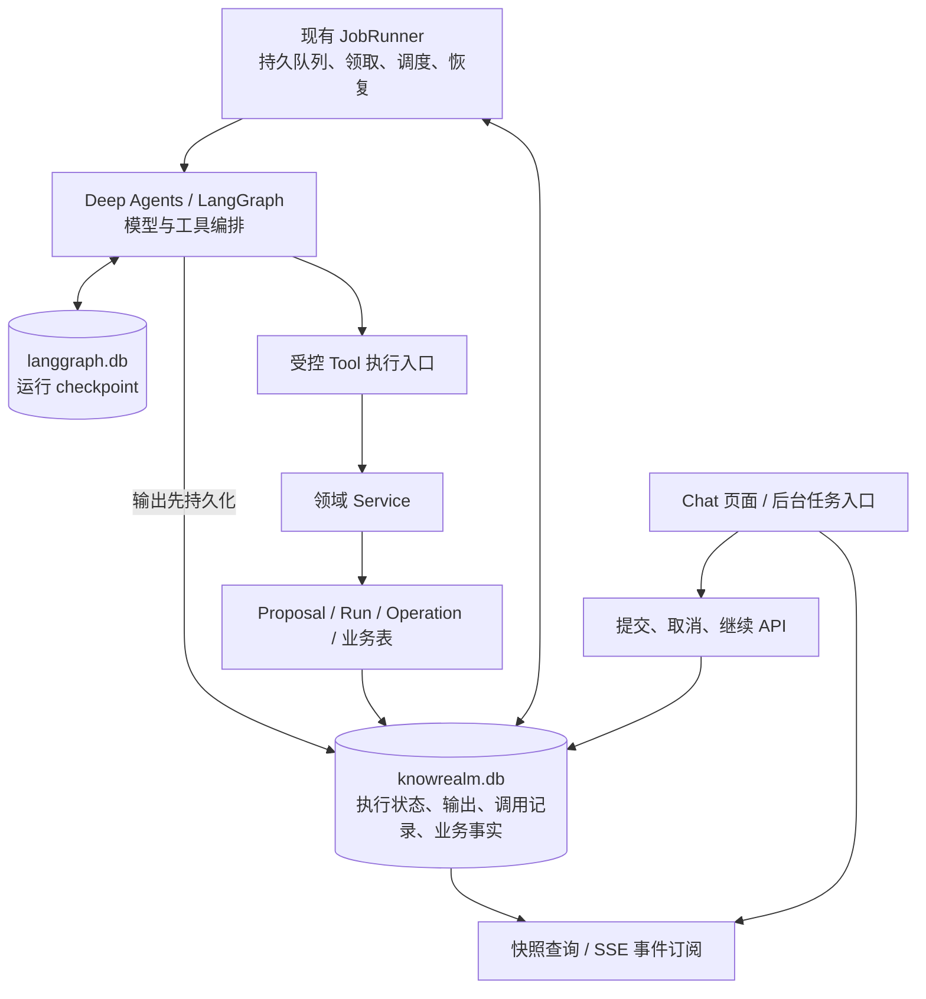

建议采用：**持久化执行单元 + 后端独立调度 + 可重放输出 + 安全恢复**。

结合当前项目，具体应落为 **ChatTurn + 现有 JobRunner + Deep Agents/LangGraph + 受控 Tool/Service 写路径**。页面负责提交、观察和控制任务；任务的生命周期由后端执行引擎管理。

本次只进行了只读核查，没有修改代码或文件。以下基于当前检出版本 `3e191b2` 的实际链路设计。

**1. 当前问题的根源**

目前执行生命周期与流式连接生命周期绑在一起：

- [ChatWorkspace.tsx](/E:/workspace/project/my/KnowRealm-AI/apps/desktop/src/features/chat/ChatWorkspace.tsx:125) 使用 `key={sessionId}`，切换会话会卸载原对话组件。
- [useChatStream.ts](/E:/workspace/project/my/KnowRealm-AI/apps/desktop/src/features/chat/useChatStream.ts:28) 在卸载时调用 `abort()`；“停止”按钮也使用同一机制。
- [chat_sessions.py](/E:/workspace/project/my/KnowRealm-AI/backend/app/modules/agent/chat_sessions.py:162) 直接把 Agent 生成器交给 SSE 响应，由连接消费生成过程。
- [message_service.py](/E:/workspace/project/my/KnowRealm-AI/backend/app/modules/agent/message_service.py:1077) 在完整生成之后才保存 assistant 正文。当前已有过程摘要持久化，但不能恢复完整的流式回答。
- [graph.py](/E:/workspace/project/my/KnowRealm-AI/backend/app/modules/agent/graph.py:738) 每轮开始前清理会话级 checkpoint，正常结束后也清理，尚未提供安全续跑契约。

因此，前端的“离开视图”会沿连接取消链影响执行。仅删除 `abort()`，无法解决刷新、重启、内容持久化和工具重复执行。

设计需要确立三个独立生命周期：

| 生命周期 | 管理者 | 结束条件 |
|---|---|---|
| 页面与订阅 | 前端、SSE 服务 | 切换会话、卸载、断线 |
| Agent 执行 | 后端执行引擎 | 完成、失败、显式取消，或进入等待 |
| 输出与业务事实 | 本地数据库 | 按保留策略清理，与连接无关 |

**订阅结束不改变执行状态。**

**2. 总体架构与职责**



各层的职责如下：

| 层 | 职责 |
|---|---|
| Chat 页面 | 显示历史、执行快照和增量输出，发出明确控制指令 |
| ChatTurn Service | 原子受理、请求去重、状态查询、取消与恢复控制 |
| JobRunner | 持久调度、并发限制、原子领取、失败与中断恢复 |
| Agent Runtime | 构造和恢复图，执行模型及工具循环，产生结构化事件 |
| Middleware | 调用前检查取消、权限、预算，关联工具调用与输出 |
| 受控执行入口、领域 Service | 最终授权、对象版本校验、业务幂等与事务提交 |
| 事件订阅服务 | 读取已提交事件、补发、通知；不启动或取消 Agent |

**复用现有 JobRunner/WorkerSpec，不另建一套任务平台。** 框架已有的图编排、checkpoint 和恢复能力继续由 LangGraph 提供。

**3. 执行对象如何划分**

需要新增 `ChatTurn`，表示“一条用户输入对应的一次回答生成”，同时保留现有对象的职责：

| 对象 | 表示什么 |
|---|---|
| ChatSession | 会话归属与历史上下文 |
| ChatTurn | 一次回答生成及其恢复信息 |
| AgentRun | 一个业务计划的执行 |
| AgentOperation | 单项业务操作及回执 |
| Proposal | 待确认的操作或内容提案 |
| ProcessingJob | 持久调度任务 |
| LangGraph checkpoint | 图的运行状态 |

这些对象不能合并。例如，“讲解 Redis”可以只有 ChatTurn；“整理五篇论文”则可能由 ChatTurn 创建 Proposal/Run，后续由 Run 独立执行。

**ChatTurn 完成不代表相关 Run 已完成；停止回答也不能通过关闭连接来代替取消业务 Run。**

建议本期补齐三类持久记录：

| 记录 | 关键内容 |
|---|---|
| `chat_turns` | 会话、输入消息、状态、取消标记、执行尝试、请求快照、checkpoint 标识、输出快照、最终消息、等待原因、错误 |
| `chat_turn_events` | 单调序号、事件类型、执行尝试、输出版本、段落与工具标识、事件载荷 |
| `agent_tool_invocations` | 稳定调用身份、参数指纹、调用状态、可恢复结果、关联 Proposal/Operation/Run/Job |

工具调用记录保存的是**执行与恢复信息**；业务操作结果仍以 Operation 和领域表为准，避免出现第二份业务事实源。

现有 `ChatResponseProcess` 可以继续服务于过程展示，但其状态应由 ChatTurn 和调用记录投影，不能再独立决定任务生命周期。

**4. 提交与订阅必须拆开**

建议提供以下契约，具体路径可按现有路由风格落定：

| 操作 | 建议接口 |
|---|---|
| 提交一轮 | `POST /api/chat-sessions/{session_id}/turns` |
| 查询会话轮次 | `GET /api/chat-sessions/{session_id}/turns` |
| 查询执行快照 | `GET /api/chat-turns/{turn_id}` |
| 补发并订阅输出 | `GET /api/chat-turns/{turn_id}/events?after_seq=N` |
| 主动停止 | `POST /api/chat-turns/{turn_id}/cancel` |
| 显式继续 | `POST /api/chat-turns/{turn_id}/resume` |

提交流程：

1. 校验会话、参数、供应商配置和必要外发同意。
2. 在**同一个数据库事务**内保存用户消息、ChatTurn 和 `CHAT_TURN` ProcessingJob。
3. 提交成功后返回 `202 + turn_id + status`。
4. JobRunner 领取任务并独立执行。
5. 前端查询快照，再订阅后续事件。

提交接口不能等待模型生成，也不能把执行体挂在请求 scope 或普通 FastAPI BackgroundTasks 上。

幂等规则：

- 客户端为一次提交生成稳定 `request_id`。
- 相同 `request_id`、相同规范化请求，返回原 turn。
- 相同 `request_id`、不同内容、范围或授权参数，返回冲突。
- 请求原文指纹与后端解析出的执行快照分别保存，重试不会因全局设置变化而被误认成新任务。

默认同一会话只允许一轮活动生成，通过数据库约束保证；不同会话可以并发。

返回会话时，必须查询**轮次与消息历史，包括离开期间已经完成的轮次**。只查询“活动任务”会漏掉这类结果。

**5. 流式输出如何持续保存**

采用 **输出快照 + 有序事件日志**。

每条事件至少具有：

```text
turn_id
seq
attempt
output_revision
type
segment_id / tool_call_id
payload
```

需要支持正文增量、可展示的过程说明、工具开始/结果、提案与回执引用、等待、恢复、完成、失败和取消事件。无需保存模型内部私有思维链。

持久化顺序必须是：

> 收集增量 → 提交事件与快照 → 通知订阅者 → 前端显示。

可以把几十毫秒内的 token 合成一批，降低 SQLite 写入频率；但**一批未提交的内容不能作为已保存输出发送给页面**。这样崩溃后，用户已经看到的输出能够从数据库恢复。

快照与订阅的衔接：

1. 后端从一致的数据库视图返回快照及 `last_seq=N`。
2. 前端先渲染快照。
3. 从 `N` 之后补发事件，再持续订阅。
4. 重复事件按 `seq` 忽略；序号缺口重新补拉。
5. 事件已压缩时返回最新快照与重置游标。

订阅通知只用于降低延迟。即使通知丢失，服务端仍能按数据库游标补发。慢客户端不能阻塞执行：积压过多时关闭该订阅，允许其重新同步。

最终正文可能经过引用解析、段落整理，因此完成事件应携带最终权威快照，不能仅依赖 token 拼接结果。

**6. 状态机与执行调度**

建议 ChatTurn 使用以下状态：

| 状态 | 含义 |
|---|---|
| `QUEUED` | 已持久受理，等待执行 |
| `RUNNING` | 正在执行 |
| `WAITING_USER` | 等待必要确认、授权或恢复决定 |
| `WAITING_JOB` | 等待已提交的后台 Job |
| `INTERRUPTED` | 执行环境中断，等待恢复对账 |
| `COMPLETED` | 最终结果已持久提交 |
| `FAILED` | 不可恢复或重试预算耗尽 |
| `CANCELLED` | 用户取消已落实 |

核心转换：

```text
QUEUED → RUNNING → COMPLETED / FAILED
             ├→ WAITING_USER → QUEUED
             ├→ WAITING_JOB  → QUEUED
             └→ INTERRUPTED → 对账后继续、等待用户或失败

非终态 + cancel_requested → CANCELLED
```

切换会话、SSE 断线、页面刷新都不触发状态转换。

调度继续使用 JobRunner：

- `CHAT_TURN` 使用独立 worker，初期采用少量固定执行槽，例如两个。
- 数据库条件更新负责领取；不能仅靠进程内集合保证互斥。
- 等待确认或后台 Job 时释放执行槽。
- 完成通知丢失后，通过周期对账重新发现可推进任务。
- 网络调用期间不持有数据库写事务。

每次领取增加执行尝试编号。事件、状态和业务提交都校验当前执行身份，防止旧 worker 的迟到结果覆盖新执行。

运行期异常恢复必须针对**具体失败任务**。不能因一个执行槽写回失败而重置所有 `RUNNING` 任务；也不能只记录日志，让轮次永久占用会话。

**7. 重启恢复：checkpoint 与业务对账同时负责**

每轮使用独立 checkpoint 标识，例如：

```text
chat-turn-{turn_id}
```

历史消息仍由业务数据库管理。首次执行构建输入，恢复时使用已有图状态，不能再次注入同一条用户输入，也不能在恢复入口清空 checkpoint。

LangGraph checkpoint 持久化的是图步骤状态，恢复可能重放节点及其调用；它不保证恢复模型服务端原来的 token 流。[官方 checkpoint 文档](https://docs.langchain.com/oss/python/langgraph/checkpointers)

因此启动对账必须区分：

| 中断位置 | 恢复动作 |
|---|---|
| 已受理、尚未开始 | 正常领取原任务 |
| 模型节点执行中 | 保留已保存输出，从最近安全边界重新执行未完成节点 |
| 工具结果已提交、checkpoint 未写完 | 查持久调用记录和业务回执，复用结果 |
| 图已完成、assistant 未落库 | 从最终图状态/结果记录补写，不再调用模型 |
| assistant 与终态已落库、客户端没收到 | 查询和补发即可 |
| 等待确认 | 保留等待状态，不自动批准 |
| 等待后台 Job | 对账原 Job，不能重复创建 |
| 取消请求已落库 | 优先落实取消，不恢复执行 |
| 图版本不兼容、外部结果不明 | 保留内容并等待明确处理 |

恢复输入必须可重建，至少保存：

- 已解析的上下文、读取范围、页面提示与来源版本。
- 模型及供应商标识、系统提示与 prompt 版本、工具集合与图版本。
- 授权依据、外发同意依据、用户时区及时间提示。
- 已使用预算、工具调用和输出版本。

凭据仍从现有配置读取，不能写入事件和 checkpoint 展示载荷。恢复必须重新校验当前权限和外发同意；原会话临时高权限不能因保存快照而无限延续。

当前项目已有 `knowrealm.db` 和 `langgraph.db` 两个存储，不能假设它们原子提交。方案必须允许两边先后落盘，并通过调用记录、业务回执和最终结果补齐差异。

**8. 安全恢复最关键的是工具副作用幂等**

checkpoint 不能关闭以下故障窗口：

```text
业务操作提交成功
→ 进程崩溃
→ 工具结果尚未写入 checkpoint
→ 恢复时再次执行工具
```

建议为每次逻辑调用建立稳定身份：

```text
调用键 = execution_id + graph_namespace + logical_call_id
副作用键 = 调用键 + effect_index
```

关键规则：

- **重试次数不进入副作用键**，否则每次重试都是新写入。
- 工具调用身份必须来自持久化后的调用计划，不能在恢复时重新随机生成。
- 相同键但参数指纹不同，应拒绝执行。
- 一次调用产生多个结果时，逐项使用稳定 `effect_index`。
- 对本地业务写入，副作用来源键、业务结果和回执应在同一事务提交。
- 恢复命中已完成记录时，返回原结构化结果和对象 ID，跳过业务写入。

覆盖范围必须包括：

- 创建、修改、归档等 Operation。
- `propose_memory`、`propose_ingest` 等提案创建。
- 批量计划及 Run 创建。
- 后台 Job 提交。
- 重试和补偿入口。

例如 `propose_ingest` 一次创建五条提案，在第三条之后崩溃，恢复只能补齐剩余结果，不能再创建五条。

对未来外部写工具，优先使用供应商幂等键或结果查询。无法判断“远端成功还是失败”的调用应进入人工核验，不能盲目自动重试。框架的 task 结果持久化有助于减少重放，但仍需处理外部提交与结果保存之间的窗口。[官方 Functional API 文档](https://docs.langchain.com/oss/python/langgraph/functional-api)

**9. 主动停止的准确语义**

停止必须是持久化控制指令：

1. API 原子写入 `cancel_requested`。
2. 唤醒对应 worker。
3. 尽力中止正在等待的模型/工具调用。
4. 在后续受控入口禁止新的副作用提交。
5. 保存已有输出、回执和取消终态。

取消检查不能只发生在“收到下一个 token”时，还应覆盖模型调用前、工具调用前、后台 Job 提交前和业务事务提交处。Middleware 负责调用检查；领域执行入口负责最终校验。

完成与取消竞态按数据库提交顺序裁决：

- 完成先提交：保留完成状态。
- 取消先提交：禁止后续新操作，保存部分结果并收尾。
- 已提交的操作保留真实回执；取消不等于撤销。
- 不可立即中断的调用显示“正在停止”，不能提前伪装成已取消。

对该任务专属创建的子 Run，停止通过现有 RunControlService 传播。共享 Job 或已经提交、按现有契约继续处理的 Job，保留结果与回执，停止后不再触发该任务的后续步骤。

关联关系必须在创建时持久保存，不能仅存在于内存，否则崩溃后无法确定停止范围。

删除正在执行的会话建议返回冲突，先要求显式停止；不要把删除隐式解释成取消。

**10. 不同异常场景的保证**

| 场景 | 设计后的行为 |
|---|---|
| 切换会话、进入其他页面 | 断开原订阅，任务继续 |
| 返回原会话 | 读取当前快照、已有输出和相关回执，再补发增量 |
| WebView 刷新 | 后端继续，页面重新同步 |
| 前后端连接断开 | 执行不受影响，重连补发 |
| 模型或工具网络失败 | 按重试策略与幂等条件处理 |
| sidecar 崩溃 | 已落盘内容保留，启动后对账恢复 |
| 整个应用退出或被强杀 | 本地执行停止，重启后恢复 |
| 用户点击停止 | 持久取消并落实，不再自动续跑 |

最后两行需要区分。当前 [sidecar.rs](/E:/workspace/project/my/KnowRealm-AI/apps/desktop/src-tauri/src/sidecar.rs:23) 使用 Windows Job Object，使 sidecar 随壳退出。因此本期应保证**退出后保留任务、重启后安全恢复**。

如果未来需要“完全退出应用后仍运行”，需要改变宿主生命周期，例如保持托盘运行或引入独立后台宿主；这属于另一个明确的产品范围。

模型节点重放时也不能把新文本直接追加到旧半段正文。使用 `output_revision` 和段落替换事件，保留旧片段供查看，明确标注重生成的未完成部分。

**11. 通用性与扩展性如何获得**

通用性应来自稳定的执行契约：

```text
持久提交
→ 原子领取
→ 执行与检查
→ 持久输出/结果
→ 查询、控制、恢复
```

- **Background Agent**：通过同一执行入口提交，任务来源可以没有 ChatSession。
- **长任务**：提交现有领域 Job，进入等待并释放槽位，完成后重新推进。
- **多 Agent**：复用框架子图能力；执行身份、checkpoint namespace、事件来源和子任务归属各自隔离。
- **Tool 执行**：统一关联调用记录、取消、预算和恢复策略，业务仍进入现有 Service。
- **多个观察者**：各自使用游标订阅同一执行，不影响任务生命。
- **更换前端或传输方式**：只更换提交/观察客户端，执行事实保持不变。

本期不用提前搭建 Multi-Agent 平台、消息中间件或分布式调度。现有 WorkerSpec 已提供真实扩展入口；新增任务类型时按契约接入即可。

**12. 实施顺序与验收**

建议按完整行为闭环分阶段：

| 阶段 | 范围 |
|---|---|
| 第一阶段 | ChatTurn、原子提交、独立 worker、输出持久化、查询/订阅、显式停止；前端完成切换恢复 |
| 第二阶段 | 工具来源键与结果恢复、独立 checkpoint、版本/预算/权限恢复、启动及运行期对账 |
| 第三阶段 | 等待 Job、专属子 Run 的控制传播、限流、事件压缩与清理约束、真实桌面故障验收 |

第一阶段可以解决切换和断线，但**第二阶段完成前不能宣称安全自动续跑**。整个需求的交付包含这三个阶段。

关键验收应验证真实行为：

1. A 会话执行中切到 B，再返回 A，执行未重启且输出完整。
2. A 在离开期间完成，返回能直接看到最终消息。
3. 刷新、断线和重复订阅，不重复提交、不丢失或重复拼接事件。
4. 在模型节点中途强杀，重启保留原输出，正确处理重放版本。
5. 在业务提交后、checkpoint 写入前强杀，不重复创建业务对象。
6. 多结果工具部分提交后强杀，恢复只补未完成项。
7. 图完成但最终消息未提交时重启，只补写结果。
8. 主动停止覆盖排队、模型调用、工具调用、等待确认与等待 Job。
9. 完成/取消、重复提交、重复恢复并发时，只有一个有效执行和终态。
10. 一个 worker 写回失败，不影响其他执行，也不留下永久 `RUNNING`。
11. 重启后权限降档、同意失效或对象版本变化，未提交步骤正确等待或拒绝。
12. 清理不能删除非终态任务依赖的 checkpoint、回执和幂等记录。

本次未运行测试或真机复现；以上是基于源码核查的设计和后续验收要求。实施时还需同步数据库迁移约束、OpenAPI 类型、双语文案与进度文档，权威文档增补遵循项目既有提案流程。
